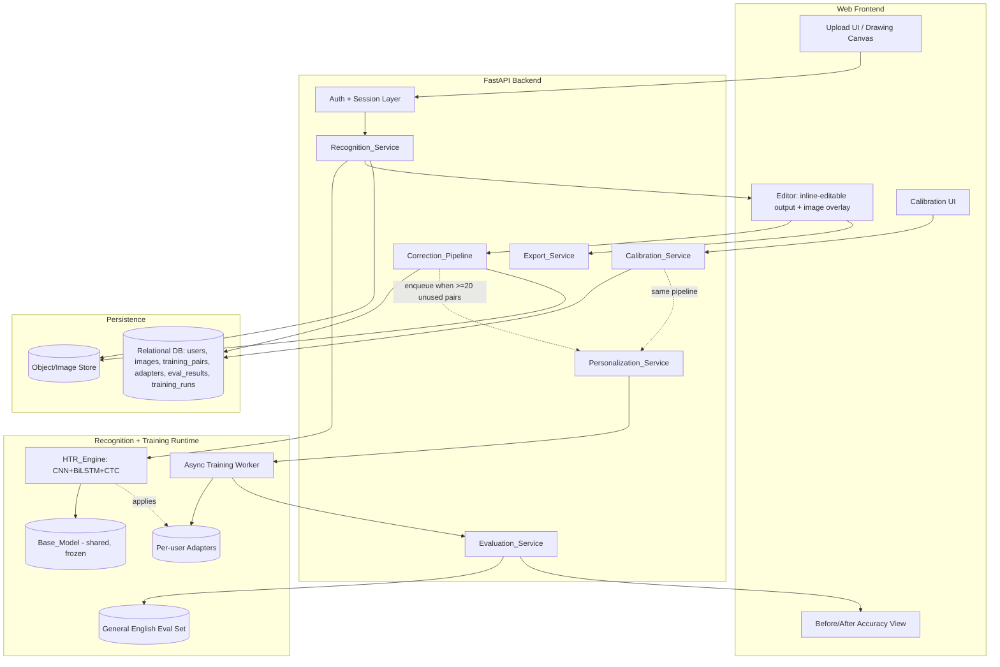
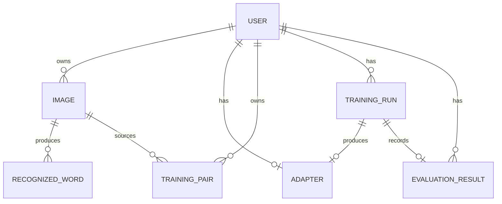

# Design Document

## Overview

The Handwriting Notes Digitizer is a web application that converts images of handwritten English notes into editable digital text and personalizes recognition to an individual writer over time. The headline outcome is a visible, measurable before/after accuracy improvement on a user's own handwriting, achieved through a human-in-the-loop correction loop that turns every inline correction into labeled training data.

This document describes a system composed of a FastAPI backend, a web frontend with image upload and inline-editable output, a PyTorch handwriting text recognition (HTR) engine based on a CNN + BiLSTM + CTC architecture, and a personalization subsystem that produces a small per-user adapter via parameter-efficient fine-tuning (PEFT) on top of a shared frozen base model. The entire system is reproducible and Dockerized for deployment as a portfolio-grade demo.

### Design Goals

1. **Visible before/after improvement** — The system measures and reports CER/WER on a per-user held-out set before and after personalization. This is the demo's headline.
2. **Corrections are the data pipeline** — The inline correction loop is the hero feature. Each correction that changes a word becomes a `Training_Pair`. Calibration is an optional cold-start accelerator feeding the *same* pipeline.
3. **One adapter per user, not one model per user** — Personalization stores only a small adapter (LoRA-style or last-layer weights) per user on top of one shared frozen base model, keeping storage and memory bounded.
4. **Safety against regression** — Personalization must never silently degrade general accuracy. Held-out evaluation plus accept/reject guardrails protect against overfitting and catastrophic forgetting.
5. **Strict per-user isolation** — A user's data, training pairs, and adapter are never visible to or mixed with another user's.
6. **Reproducibility** — The base model trains from a documented public English dataset (IAM) with pinned configuration, and the whole system builds from pinned dependencies in Docker.

### Key Research Findings

- **Architecture baseline.** A CNN + BiLSTM + CTC ("CRNN") network is a well-established, reproducible HTR architecture. Reported results range from a strong ~3.59% CER / 9.44% WER under favorable conditions to a realistic full-system ~13% CER / ~42% WER on the IAM line-level test set, which sets reasonable expectations for the base model ([CNN-BiLSTM for English HTR, arXiv:2307.00664](https://arxiv.org/abs/2307.00664); [IAM CNN-BiLSTM-CTC model card](https://huggingface.co/IsmatS/handwriting-recognition-iam)). Content was rephrased for compliance with licensing restrictions.
- **PEFT for handwriting.** Parameter-efficient fine-tuning updates only a small set of added parameters while keeping the pretrained model frozen, which reduces memory and is well suited to small per-user datasets ([HF PEFT docs](https://huggingface.co/docs/peft/index)). LoRA encodes a weight update as the product of two low-rank matrices ([LoRA, arXiv:2106.09685](https://arxiv.org/abs/2106.09685)), and recent work evaluates LoRA/DoRA specifically for handwriting text recognition in limited-data setups ([LoRA vs Fine-Tuning for HTR, WACV 2025](https://openaccess.thecvf.com/content/WACV2025W/VISIONDOCS/html/Huttner_Low-Rank_Adaptation_vs._Fine-Tuning_for_Handwritten_Text_Recognition_WACVW_2025_paper.html)). This validates the per-user adapter approach over full fine-tuning. Content was rephrased for compliance with licensing restrictions.
- **Transfer learning for small handwriting datasets.** Adapting a general CLC (CNN-LSTM-CTC) model to a specific calligraphy with limited transcribed text is a known challenge addressed by transfer learning ([Boosting HTR in Small Databases, arXiv:1804.01527](https://arxiv.org/abs/1804.01527)), which motivates the held-out evaluation and early-stopping guardrails.

### Scope Constraints

- English handwriting only (single language); no multilingual support.
- Offline (image-based) HTR; no online stroke capture is required, though the frontend may offer a drawing canvas that produces an image.
- Personalization targets a single writer per account.

## Architecture

### Component Map

The design maps directly onto the requirements glossary. Each named component is a discrete module with a clear responsibility.



### Architectural Style

- **Service-oriented modular monolith.** All backend services run within one FastAPI application for deployment simplicity (single container or small compose stack), but are organized as independent modules with explicit interfaces so a capability can be disabled in a partial deployment (Req 11.5–11.6).
- **Synchronous recognition, asynchronous training.** Recognition is request/response and must meet a 10-second budget (Req 2.3). Adapter training is long-running and runs on a background worker queue so it never blocks recognition, correction, or export (Req 5.1, Req 8.4).
- **Frozen base + pluggable adapter.** The `Base_Model` is loaded once and shared across all requests. A user's `Adapter` is loaded and composed with the base model at recognition time. Adapters are small enough to cache per active user.

### Request Lifecycle Overview

1. **Recognition flow** (synchronous): authenticated upload → validation → HTR inference (base + optional user adapter) → segmented word/line result with regions → returned to Editor.
2. **Correction flow** (synchronous write + async trigger): user edits a word → on confirm, if changed, a `Training_Pair` is created/updated → when the user accumulates ≥ 20 unused pairs, a training job is enqueued.
3. **Personalization flow** (asynchronous): worker reserves a held-out set, trains the adapter with PEFT and early stopping, evaluates on the general set and the user held-out set, then accepts or rejects the new adapter under the guardrails.
4. **Evaluation reporting** (asynchronous result, synchronous read): before/after CER and WER on the held-out set are stored and surfaced to the user.
5. **Export flow** (synchronous): current edited text is serialized to plain text or markdown.

### Asynchronous Training Architecture

A background worker (e.g., an in-process task queue such as a thread/async worker for the demo, or an external queue like Redis + RQ/Celery for scale) consumes training jobs. A per-user mutex/lock ensures no two adapter trainings run concurrently for the same user (Req 5.6). The training trigger is a debounced check evaluated when training pairs change: when the count of pairs not yet consumed by a *completed* training reaches the threshold (20), a job is enqueued within 60 seconds (Req 5.1).

## Components and Interfaces

This section describes each component's responsibility and its primary interface. Interfaces are expressed as logical operations; the API surface section maps them to HTTP endpoints.

### HTR_Engine

Responsibility: map a handwriting image to recognized text segmented into lines and words, each with a bounding region (Req 2.1, 2.2, 2.4). Built in PyTorch as CNN + BiLSTM + CTC. Optionally exported to ONNX for portable, faster inference.

Pipeline:
1. **Preprocess** — decode, grayscale, deskew, normalize height, binarize as needed.
2. **Layout/segmentation** — detect text lines (top-to-bottom) and word boundaries within each line (left-to-right). For the demo, a projection-profile / connected-component segmenter produces line and word crops with coordinates.
3. **Recognize** — run each line (or word) crop through CNN feature extractor → BiLSTM sequence model → CTC decoder (greedy or beam) to produce text.
4. **Assemble** — return ordered lines, each with ordered words, each word carrying its source region coordinates.

Interface:
```
recognize(image: DecodedImage, adapter: Adapter | None) -> RecognitionResult
    RecognitionResult = { lines: [ { index, region, words: [ { index, text, region, confidence } ] } ],
                          recognized_any_text: bool }
```

The engine accepts an optional `adapter`. When present, adapter weights are composed with the frozen base weights for that inference (Req 5.4); when absent, the base model alone is used (Req 5.5).

### Recognition_Service

Responsibility: accept uploads, enforce validation and auth, orchestrate the HTR_Engine with the correct adapter, enforce the recognition time budget, and associate results with the user (Req 1, Req 2, Req 10.3).

Behavior:
- Validates auth first (Req 1.5, 10.1, 10.4). Rejects unauthenticated requests without storing anything.
- Validates format (PNG/JPEG by decoded content, not extension), size (> 0 and ≤ 10 MB), and decodability (Req 1.1–1.4).
- On acceptance, persists the image associated with the user (Req 1.6) and selects the user's adapter if one exists.
- Enforces a 10-second recognition budget; on timeout, cancels and returns a timeout error while retaining the image (Req 2.6). On engine failure, returns a failure error without modifying stored data (Req 2.7). On no detected text, returns a "no text recognized" result (Req 2.5).

Interface:
```
submit_image(user, file_bytes) -> Accepted{image_id} | Rejected{reason}
recognize(user, image_id) -> RecognitionResult | NoText | TimeoutError | RecognitionError
```

### Editor (Frontend)

Responsibility: display the recognized text alongside the original image and support inline editing (Req 3, Req 4).

Behavior:
- Renders recognized text in reading order (lines top-to-bottom, words left-to-right) with the original image visible simultaneously (Req 3.2, 3.3), within latency budgets (Req 3.1, 4.2).
- Allows editing any word, accepting up to 10,000 characters per word (Req 4.1).
- On confirm, calls the Correction_Pipeline for changed words only and updates the display (Req 4.2, 4.3, 4.4).
- Displays a "no text recognized" message with the image when applicable (Req 3.4).

### Correction_Pipeline

Responsibility: capture confirmed corrections that change a word as `Training_Pair`s and persist them under the user's account (Req 4.3–4.8).

Behavior:
- On a confirmed edit where corrected text differs from recognized text for a word, create a `Training_Pair` = (image region crop, corrected text) (Req 4.3).
- If the confirmed text equals the recognized text, leave stored pairs unchanged (Req 4.4). Editing without confirming changes nothing (Req 4.8).
- Re-correcting the same region updates that region's pair to the most recent text rather than creating a duplicate (Req 4.7) — an upsert keyed by (user, image_region).
- Persist within 5 seconds (Req 4.5). On storage failure, return an error, keep the displayed corrected text in the Editor, and leave previously stored pairs unchanged (Req 4.6).

Interface:
```
submit_correction(user, image_id, region, recognized_text, corrected_text)
    -> Created{pair_id} | Updated{pair_id} | NoChange | StorageError
```

### Calibration_Service

Responsibility: optional cold-start accelerator that presents known prompt sentences and turns submitted handwriting into `Training_Pair`s in the *same* store as the Correction_Pipeline (Req 9).

Behavior:
- Entirely optional; the system functions without it (Req 9.1).
- Presents 3–10 prompts, each 1–200 characters (Req 9.2).
- For each submitted prompt image, validates (non-empty, ≤ 10 MB, detectable handwriting region) and on success creates a `Training_Pair` using the submitted region and the known prompt text (Req 9.3, 9.5). Invalid submissions are rejected with a reason and create no pair (Req 9.4).
- Calibration pairs feed the same Personalization_Service pipeline (Req 9.6).

### Personalization_Service

Responsibility: train and manage a single per-user `Adapter` using PEFT, enforce concurrency and guardrails, and govern which recognition configuration is active (Req 5, Req 6, Req 10.2).

Behavior:
- Triggers training when a user has ≥ 20 training pairs not yet consumed by a completed training (Req 5.1).
- Trains only adapter parameters; base parameters stay frozen (Req 5.2). Stores exactly one adapter per user (Req 5.3).
- Uses only that user's training pairs (Req 10.2).
- Holds a per-user training lock to prevent concurrent trainings (Req 5.6).
- Reserves a held-out set of max(20% of pairs, 5 pairs) excluded from training (Req 6.1).
- Early stopping: stop when held-out CER fails to improve by ≥ 0.5 pp over 3 consecutive evaluation cycles, and never exceed 50 epochs (Req 6.5).
- After training, accept/reject the new adapter under the guardrails (Req 6.3, 6.4) and only then mark the consumed pairs and activate the adapter.
- On training failure or rejection, retain the previously active configuration and record the outcome; notify the user on rejection (Req 5.7, 6.6).

Interface:
```
maybe_enqueue_training(user) -> Enqueued | BelowThreshold | AlreadyRunning
train_adapter(user) -> Accepted{adapter_id, eval} | Rejected{reason, eval} | Failed{reason}
active_config(user) -> { adapter_id | None }
```

### Evaluation_Service

Responsibility: compute CER and WER and report before/after results (Req 6.2, Req 7).

Behavior:
- Computes CER/WER as character/word-level Levenshtein distance (substitutions + insertions + deletions) over reference length, yielding a non-negative ratio (Req 7.4, 7.5).
- On adapter training, measures base-model and adapter CER/WER on the user's held-out set when it has ≥ 1 reference character and word (Req 7.1, 7.2), and measures adapter CER/WER on the general English eval set for the guardrails (Req 6.2).
- Reports before, after, and delta (before − after) for CER and WER (Req 7.3).
- If the held-out set lacks reference characters/words, reports measurement unavailable (Req 7.6). On computation failure, reports unavailable while retaining any successfully computed measurement (Req 7.7).

Interface:
```
cer(reference: str, hypothesis: str) -> float   # >= 0
wer(reference: str, hypothesis: str) -> float    # >= 0
evaluate_user(user, base_model, adapter) -> BeforeAfterReport | Unavailable
```

### Export_Service

Responsibility: produce copyable plain-text or markdown output of the current edited text (Req 8).

Behavior:
- Plain text preserves line breaks (Req 8.1); markdown preserves line and paragraph structure (Req 8.2).
- Reflects every confirmed correction present in the Editor at request time (Req 8.3) and never waits for training (Req 8.4).
- Empty edited text returns a "nothing to export" message and produces no output (Req 8.5). On failure, returns a failure indication and leaves text unchanged (Req 8.6).

Interface:
```
export(edited_text, format: "plain" | "markdown") -> Output{content} | Empty | ExportError
```

### Auth + Session Layer

Responsibility: authenticate users and enforce per-user data isolation across all services (Req 10).

Behavior:
- Requires authentication before image submission, corrections, or calibration (Req 10.1, 10.4).
- Scopes every data access by the authenticated user id; denies cross-user access to training pairs, recognized text, or adapters without disclosing the other user's data (Req 10.5).

### API Surface

All endpoints require authentication unless noted. All data-bearing endpoints are scoped to the authenticated user; a request for a resource owned by another user returns 404 (not 403) so existence is not disclosed (Req 10.5).

| Method | Path | Purpose | Key Requirements |
|--------|------|---------|------------------|
| POST | `/auth/login` | Authenticate, establish session/token | 10.1 |
| POST | `/images` | Upload + validate image, associate with user | 1.1–1.6, 10.4 |
| POST | `/images/{image_id}/recognize` | Run recognition (base + adapter) | 2.1–2.7, 5.4, 5.5, 10.3 |
| GET | `/images/{image_id}/result` | Fetch recognition result for display | 3.1–3.4 |
| POST | `/images/{image_id}/corrections` | Submit a confirmed correction → Training_Pair upsert | 4.3–4.8 |
| GET | `/training-pairs` | List the user's own training pairs (metadata) | 10.2, 10.5 |
| POST | `/calibration/session` | Start calibration, return 3–10 prompts | 9.1, 9.2 |
| POST | `/calibration/{session_id}/samples` | Submit a calibration handwriting image | 9.3–9.5 |
| GET | `/personalization/status` | Training status + active config for the user | 5.6, 5.7 |
| GET | `/personalization/evaluation` | Before/after CER/WER report | 6.6, 7.3, 7.6, 7.7 |
| POST | `/export` | Export edited text as plain or markdown | 8.1–8.6 |
| GET | `/health` | Component availability (for partial deployment) | 11.5, 11.6 |

Training is never invoked directly by a client; it is enqueued internally by the Correction_Pipeline / Calibration_Service when the threshold is reached (Req 5.1).

Partial-deployment behavior: `/health` reports which capabilities are available. Any endpoint whose backing component is unavailable returns a structured "capability unavailable" response (Req 11.6) while available capabilities continue to serve (Req 11.5).

## Data Models

The system uses a relational database for structured records and an object store for image bytes and crops. Adapter weight files are stored in the object/model store and referenced by path.

### Entity Relationship Overview



### User

| Field | Type | Notes |
|-------|------|-------|
| user_id | UUID (PK) | |
| email / username | string, unique | |
| password_hash | string | hashed credential |
| created_at | timestamp | |

### Image

| Field | Type | Notes |
|-------|------|-------|
| image_id | UUID (PK) | |
| user_id | UUID (FK) | ownership; all queries scoped by this (Req 1.6, 10.x) |
| storage_path | string | object store reference |
| format | enum(PNG, JPEG) | from decoded content |
| size_bytes | int | ≤ 10,485,760 |
| status | enum(accepted, recognized, no_text, timeout, error) | Req 2.5–2.7 |
| created_at | timestamp | |

### RecognizedWord

| Field | Type | Notes |
|-------|------|-------|
| word_id | UUID (PK) | |
| image_id | UUID (FK) | |
| line_index | int | reading order top-to-bottom (Req 3.2) |
| word_index | int | reading order left-to-right (Req 3.2) |
| text | string | recognized text |
| region | {x, y, width, height} | source coordinates (Req 2.4) |
| confidence | float (optional) | |

### TrainingPair

Keyed for idempotent re-correction: a unique constraint on (user_id, source_region_key) lets re-corrections upsert rather than duplicate (Req 4.7).

| Field | Type | Notes |
|-------|------|-------|
| pair_id | UUID (PK) | |
| user_id | UUID (FK) | isolation (Req 10.2) |
| image_id | UUID (FK, nullable) | source image (null/synthetic allowed for calibration) |
| source_region_key | string | stable identity of the corrected region (image_id + region), unique per user |
| region_crop_path | string | stored handwriting image region |
| corrected_text | string | label; up to 10,000 chars (Req 4.1) |
| origin | enum(correction, calibration) | both feed same pipeline (Req 9.5, 9.6) |
| consumed_by_run_id | UUID (FK, nullable) | set when a *completed* training consumes it; drives the "unused pair" count (Req 5.1) |
| created_at / updated_at | timestamp | updated_at advances on re-correction (Req 4.7) |

### Adapter

| Field | Type | Notes |
|-------|------|-------|
| adapter_id | UUID (PK) | |
| user_id | UUID (FK, unique) | exactly one active adapter per user (Req 5.3) |
| weights_path | string | small PEFT weights (LoRA / last-layer), not a full model copy |
| base_model_version | string | base model this adapter composes with |
| status | enum(active, superseded) | |
| created_at | timestamp | |

### TrainingRun

| Field | Type | Notes |
|-------|------|-------|
| run_id | UUID (PK) | |
| user_id | UUID (FK) | |
| state | enum(queued, running, accepted, rejected, failed) | Req 5.6, 5.7, 6.3, 6.4 |
| pair_ids | list/junction | training pairs included (excludes held-out) |
| held_out_pair_ids | list/junction | reserved set (Req 6.1) |
| epochs_run | int | ≤ 50 (Req 6.5) |
| reject_reason | string (nullable) | e.g., general-CER-regression (Req 6.3/6.4) |
| started_at / finished_at | timestamp | trigger within 60s (Req 5.1) |

### EvaluationResult

| Field | Type | Notes |
|-------|------|-------|
| eval_id | UUID (PK) | |
| run_id | UUID (FK) | |
| user_id | UUID (FK) | |
| before_cer / before_wer | float (nullable) | base on held-out (Req 7.1) |
| after_cer / after_wer | float (nullable) | adapter on held-out (Req 7.2) |
| delta_cer / delta_wer | float (nullable) | before − after (Req 7.3) |
| general_cer / general_wer | float (nullable) | adapter on general set (Req 6.2) |
| availability | enum(available, unavailable) | Req 7.6, 7.7 |

### Domain Value Objects

- **Region**: `{x, y, width, height}` in image pixel coordinates.
- **RecognitionResult**: ordered lines → ordered words (text + region + confidence) + `recognized_any_text` flag.
- **BeforeAfterReport**: before/after/delta CER and WER plus availability.

## Correctness Properties

*A property is a characteristic or behavior that should hold true across all valid executions of a system — essentially, a formal statement about what the system should do. Properties serve as the bridge between human-readable specifications and machine-verifiable correctness guarantees.*

These properties target the pure-logic and invariant-bearing parts of the system (validation, metrics, split sizing, guardrail decisions, correction upserts, and isolation). ML inference quality, UI latency, build reproducibility, and deployment wiring are validated by example, integration, and smoke tests in the Testing Strategy instead.

### Property 1: Image validation accepts exactly the valid set

*For any* uploaded file, the validator accepts it if and only if its decoded content is a PNG or JPEG image with size greater than 0 bytes and no greater than 10,485,760 bytes; every rejection carries a reason identifying the violated rule (unsupported format, size limit, or invalid image).

**Validates: Requirements 1.1, 1.2, 1.3, 1.4**

### Property 2: Authentication gate stores nothing on unauthenticated requests

*For any* image, correction, or calibration submission made without valid authentication, the request is rejected with an authentication-required indication and the persisted-data state is identical before and after the request.

**Validates: Requirements 1.5, 10.1, 10.4**

### Property 3: Accepted images are owned by their submitter

*For any* accepted image submission by an authenticated user, the stored image's owning user identifier equals the submitting user's identifier.

**Validates: Requirements 1.6**

### Property 4: Every recognized word carries a valid region

*For any* recognition result produced by the assembler, each recognized word has a region whose coordinates are non-negative and lie within the bounds of the source image.

**Validates: Requirements 2.4**

### Property 5: Recognition timeout retains the image

*For any* recognition attempt whose processing exceeds the time budget, the service returns a timeout error result and the accepted image remains stored and associated with the user.

**Validates: Requirements 2.6**

### Property 6: Engine failure leaves stored data unchanged

*For any* recognition attempt in which the HTR engine fails, the service returns a recognition-failed error and the user's stored data is identical before and after the attempt.

**Validates: Requirements 2.7**

### Property 7: Display order follows reading order

*For any* recognition result, the order in which words are presented equals the result of ordering lines top-to-bottom and words within each line left-to-right.

**Validates: Requirements 3.2**

### Property 8: A training pair is created exactly when a confirmed edit changes a word

*For any* confirmed edit on a recognized word, a training pair (image region paired with corrected text) is created if and only if the corrected text differs from the recognized text; when the texts are identical, or while editing is unconfirmed, the user's stored training pairs are unchanged.

**Validates: Requirements 4.3, 4.4, 4.8**

### Property 9: Re-correcting a region is idempotent and last-write-wins

*For any* sequence of confirmed corrections applied to the same image region, the user ends with exactly one training pair for that region whose corrected text equals the most recent correction, with no duplicate pairs for that region.

**Validates: Requirements 4.7**

### Property 10: Correction storage failure preserves prior pairs

*For any* correction whose storage fails, the pipeline returns an error indication and the user's previously stored training pairs are identical before and after the attempt.

**Validates: Requirements 4.6**

### Property 11: Training triggers exactly at the unused-pair threshold

*For any* count of training pairs not yet consumed by a completed training, the personalization service enqueues a training job if and only if that count is at least 20.

**Validates: Requirements 5.1**

### Property 12: Base model parameters are unchanged by training

*For any* adapter training run, the shared base model parameters are identical before and after training; only adapter parameters change.

**Validates: Requirements 5.2**

### Property 13: At most one adapter per user

*For any* sequence of training runs for a user, the user has at most one active adapter at any time, and never a full per-user copy of the base model.

**Validates: Requirements 5.3**

### Property 14: Recognition applies the adapter exactly when one exists

*For any* recognition request, the engine composes the user's adapter with the base model if and only if that user has an active adapter; otherwise it uses the base model alone.

**Validates: Requirements 5.4, 5.5**

### Property 15: No concurrent training per user

*For any* interleaving of training-start attempts for a single user, at most one training run for that user is in the running state at any instant.

**Validates: Requirements 5.6**

### Property 16: Training failure retains the prior active configuration

*For any* adapter training that does not complete successfully, the user's active recognition configuration after the run equals the configuration before the run, and the run is recorded as failed.

**Validates: Requirements 5.7**

### Property 17: Held-out set sizing and disjointness

*For any* set of N of a user's training pairs, the reserved held-out set has size equal to max(round(0.2 × N), 5) bounded by N, the held-out set and the training set are disjoint, and together they partition the user's pairs.

**Validates: Requirements 6.1**

### Property 18: Adapter accept/reject guardrail decision

*For any* measured base-model and adapter CER and WER on the general English evaluation set, the new adapter is accepted if and only if the adapter's CER exceeds the base CER by no more than 1.0 percentage point AND the adapter's WER exceeds the base WER by no more than 2.0 percentage points; otherwise the adapter is rejected and the previously active configuration is retained.

**Validates: Requirements 6.3, 6.4**

### Property 19: Early-stopping criterion

*For any* sequence of held-out CER evaluation values, training stops at the first point where the held-out CER has not improved by at least 0.5 percentage point over 3 consecutive evaluation cycles, and in all cases training never runs beyond 50 epochs.

**Validates: Requirements 6.5**

### Property 20: Reported delta equals before minus after

*For any* before-personalization and after-personalization measurements, the reported change in CER equals before-CER minus after-CER and the reported change in WER equals before-WER minus after-WER.

**Validates: Requirements 7.3**

### Property 21: CER and WER metric definition and non-negativity

*For any* reference and hypothesis text, CER equals the character-level Levenshtein distance divided by the number of reference characters and WER equals the word-level Levenshtein distance divided by the number of reference words; both are non-negative, both are zero when reference and hypothesis are identical, and an empty reference yields an "unavailable" result rather than a division error.

**Validates: Requirements 7.4, 7.5, 7.6**

### Property 22: Partial measurement failure retains successful measurements

*For any* evaluation in which one of the CER/WER measurements fails to compute, that measurement is reported as unavailable while every successfully computed measurement is retained and reported.

**Validates: Requirements 7.7**

### Property 23: Export fidelity preserves structure and current corrections

*For any* current edited text, plain-text export preserves line-break structure and markdown export preserves line and paragraph structure, and in both cases the output content reflects every confirmed correction present in the editor at request time.

**Validates: Requirements 8.1, 8.2, 8.3**

### Property 24: Calibration prompt-set bounds

*For any* calibration session the service presents, the number of prompt sentences is between 3 and 10 inclusive and each prompt's length is between 1 and 200 characters inclusive.

**Validates: Requirements 9.2**

### Property 25: Valid calibration submission creates a labeled pair; invalid does not

*For any* calibration submission: if the image is non-empty, no larger than 10 MB, and contains a detectable handwriting region, a training pair is created whose corrected text equals the known prompt text and whose origin is calibration; otherwise the submission is rejected with a reason and no training pair is created.

**Validates: Requirements 9.3, 9.4**

### Property 26: A user's training set is exactly that user's pairs across all origins

*For any* collection of training pairs spanning multiple users and both origins (correction and calibration), the training candidate set selected for a given user consists of exactly that user's own pairs and no pairs belonging to any other user.

**Validates: Requirements 9.6, 10.2**

### Property 27: Recognition uses only the requesting user's adapter

*For any* set of users that each may have an adapter, recognizing a given user's image applies only that user's adapter and never any other user's adapter.

**Validates: Requirements 10.3**

### Property 28: Cross-user access is denied without disclosure

*For any* pair of distinct users A and B, a request by B to access A's training pairs, recognized text, or adapter is denied and returns none of A's data.

**Validates: Requirements 10.5**

## Error Handling

Errors are handled per-component with the guiding principle that a failure must never silently corrupt user data or silently degrade recognition accuracy. All error responses are structured (machine-readable code + human-readable message).

### Upload and Validation Errors (Req 1)

| Condition | Response | Side effects |
|-----------|----------|--------------|
| Unsupported format | 415, message naming PNG/JPEG | none; nothing stored |
| > 10 MB | 413, message stating 10 MB max | none; nothing stored |
| Empty / undecodable | 422, invalid-image message | none; nothing stored |
| Unauthenticated | 401, auth-required message | none; nothing stored (Property 2) |

### Recognition Errors (Req 2)

- **Timeout** (> 10 s): cancel the inference task, return a timeout error, retain the accepted image (Property 5). Implemented with a hard deadline around the inference call.
- **Engine failure**: catch exceptions, return recognition-failed, leave stored data unchanged (Property 6).
- **No text detected**: return a structured no-text result (not an error) so the Editor can show the image plus a message (Req 3.4).

### Correction Errors (Req 4)

- **Storage failure**: return an error, keep the corrected text visible in the Editor, leave previously stored pairs unchanged (Property 10). Writes are transactional so a failed upsert does not partially mutate state.
- **Oversized correction** (> 10,000 chars per word): reject at the Editor boundary (Req 4.1).

### Personalization Errors (Req 5, 6)

- **Training failure**: mark the run failed, retain the prior active configuration, record the outcome (Property 16).
- **Guardrail rejection**: keep prior configuration, record "did not improve," notify the user (Req 6.6).
- **Concurrency**: a per-user lock makes a second start attempt a no-op while one is running (Property 15).
- **Determinism**: training uses fixed seeds where feasible so accepted/rejected outcomes are reproducible for the demo.

### Evaluation Errors (Req 7)

- **Empty reference**: report measurement unavailable rather than divide by zero (Property 21).
- **Partial computation failure**: report the failed measurement as unavailable while retaining any successful one (Property 22).

### Export Errors (Req 8)

- **Empty edited text**: return a nothing-to-export message and produce no output (Req 8.5).
- **Export failure**: return a failure indication, leave the edited text unchanged (Req 8.6).

### Isolation and Authorization Errors (Req 10)

- Cross-user resource access returns 404 (not 403) to avoid disclosing existence (Property 28).
- Every query is scoped by the authenticated user id at the data-access layer, not just in route handlers, to provide defense in depth.

### Partial Deployment (Req 11)

- A capability registry maps each capability to its required components. `/health` exposes availability.
- When a capability's components are unavailable, its endpoints return a structured "capability unavailable" response (Req 11.6) while available capabilities continue serving (Req 11.5). For example, if the training worker is down, recognition/correction/export still work and only personalization reports unavailable.

## Testing Strategy

The strategy combines property-based tests (universal invariants and pure logic), example/unit tests (specific behaviors and UI), integration tests (timing, ML, persistence, external wiring), and smoke tests (build, deployment, reproducibility). This dual approach is intentional: property tests verify general correctness across the input space while unit/integration tests pin down concrete behaviors and infrastructure.

### Property-Based Testing

Property-based testing applies to the system's pure-logic and invariant-bearing layers, which is where input variation reveals bugs:

- **Metrics** (CER/WER definition, non-negativity, identity, empty-reference handling, delta arithmetic).
- **Validation** (image and calibration submission accept/reject including boundaries).
- **Correction logic** (create-on-change, idempotent re-correction upsert).
- **Personalization decision logic** (threshold trigger, held-out split sizing, accept/reject guardrail, early stopping).
- **Invariants** (adapter cardinality, base-frozen, no-concurrency, training/error retention).
- **Isolation** (per-user training set selection, adapter application, cross-user denial).
- **Export fidelity** and **calibration prompt bounds**.

Library and configuration:
- Python backend/ML logic: **Hypothesis**. Frontend/TypeScript logic (display ordering, editor state): **fast-check**.
- Do NOT implement property-based testing from scratch — use the chosen libraries.
- Each property test runs a **minimum of 100 iterations**.
- Each property test is tagged with a comment referencing its design property, in the format:
  **Feature: handwriting-notes-digitizer, Property {number}: {property_text}**
- Each correctness property (Properties 1–28) is implemented by a **single** property-based test.

Generators of note:
- File payloads with controllable magic bytes, decodability, and size around the 10 MB boundary (Property 1).
- Reference/hypothesis text pairs including empty, whitespace, Unicode, and long strings (Property 21).
- Multi-user pair collections with mixed origins for isolation properties (Properties 26–28).
- Held-out CER trajectories (improving, plateauing, oscillating) for early stopping (Property 19).
- Correction sequences targeting the same region for idempotence (Property 9).

For invariants that touch training (Properties 12, 13, 15, 16) the base model and trainer are replaced with small fakes/mocks so 100+ iterations are cheap; the invariant logic (locking, parameter freezing, config retention) is exercised without real GPU training.

### Example / Unit Tests

- HTR output on fixed sample images: lines/words produced, segmentation into words not isolated characters (Req 2.1, 2.2).
- No-text image fixture → no-text result (Req 2.5).
- Editor component: render within budget, show image + text together, no-text message, update on confirm, 10,000-char edit boundary (Req 3.1, 3.3, 3.4, 4.1, 4.2).
- Export edge cases: empty text message, export failure handling (Req 8.5, 8.6), export-while-training-pending uses current text (Req 8.4).
- Calibration optionality: full flow without calibration (Req 9.1); same-store assertion (Req 9.5).
- Rejection side effects: notification + record produced on guardrail rejection (Req 6.6).

### Integration Tests

- Recognition latency: ~100-word fixtures return within 10 s (Req 2.3); 1–3 representative runs.
- Training trigger timing: enqueue within 60 s of reaching threshold (Req 5.1 timing portion).
- Correction persistence latency within 5 s (Req 4.5).
- Adapter applied end-to-end at inference (Req 5.4) and general-set measurement recorded post-training (Req 6.2).
- Partial-deployment routing: disable a component and assert available capabilities serve while the unavailable one is flagged (Req 11.5, 11.6).

### Smoke / Reproducibility Tests

- Container builds from a clean checkout with pinned dependencies and no manual code edits (Req 11.1).
- Documented base-model training procedure exists and is runnable, specifying dataset version, split, and configuration (Req 11.2).
- Re-running base-model training with the fixed seed/config produces CER/WER within the configured tolerance on the fixed evaluation set (Req 11.3); 1–2 runs.
- Full deployment exposes upload, recognition, correction, personalization, and export through the UI (Req 11.4).

### Coverage Map (Requirements → Test Type)

- Property-based: 1.1–1.6, 2.4, 2.6, 2.7, 3.2, 4.3, 4.4, 4.6, 4.7, 4.8, 5.1–5.7, 6.1, 6.3, 6.4, 6.5, 7.3, 7.4, 7.5, 7.6, 7.7, 8.1, 8.2, 8.3, 9.2, 9.3, 9.4, 9.6, 10.1, 10.2, 10.3, 10.4, 10.5.
- Example/unit: 2.1, 2.2, 2.5, 3.1, 3.3, 3.4, 4.1, 4.2, 6.6, 8.4, 8.5, 8.6, 9.1, 9.5, 11.5, 11.6.
- Integration: 2.3, 4.5, 5.1 (timing), 6.2, 11.3.
- Smoke: 11.1, 11.2, 11.4.

## Reproducibility and Deployment

### Base Model Training Procedure (Req 11.2, 11.3)

- **Dataset**: IAM Handwriting Database (English), pinned to a documented version and a fixed train/validation/test split. The split definition is checked into the repo.
- **Architecture**: CNN feature extractor → BiLSTM → CTC decoder, defined in PyTorch with a pinned configuration file (layer sizes, learning rate, batch size, epochs, augmentation).
- **Determinism**: fixed random seeds and deterministic data ordering so re-execution reproduces CER/WER within a configured tolerance on the fixed evaluation set (Req 11.3).
- **Export**: the trained base model may be exported to ONNX for portable, faster inference; adapters compose with the (frozen) base at load time.
- **General English evaluation set**: a held-aside fixed subset used by the guardrails (Req 6.2) is documented and versioned.

### Personalization Mechanics

- **Adapter form**: LoRA-style low-rank adapters on the recurrent/linear layers, or a last-layer fine-tune, whichever yields the better accuracy/size tradeoff in the chosen architecture. Both keep the base frozen and produce a small weights file per user (Property 12, 13).
- **Composition**: at recognition time the adapter weights are merged or applied alongside the frozen base for that user's request only (Properties 14, 27).

### Containerization (Req 11.1, 11.4, 11.5)

- A Dockerfile (or compose file) builds frontend, backend, and recognition runtime from pinned dependency versions with no manual code modification.
- Target deployment: a single container or small compose stack deployable to Hugging Face Spaces or Render.
- Components are independently togglable so a partial deployment degrades gracefully (capability registry + `/health`), serving available capabilities and flagging unavailable ones (Req 11.5, 11.6).

### Security Note

All data endpoints require authentication and are scoped per user at the data-access layer. The demo deployment should run behind HTTPS, store password hashes (never plaintext), and treat uploaded image bytes as untrusted input (decode-and-validate before any processing). If deployed publicly without a real user base, a lightweight auth scheme is acceptable for the demo but the per-user isolation invariants (Properties 2, 26, 27, 28) must still hold.
