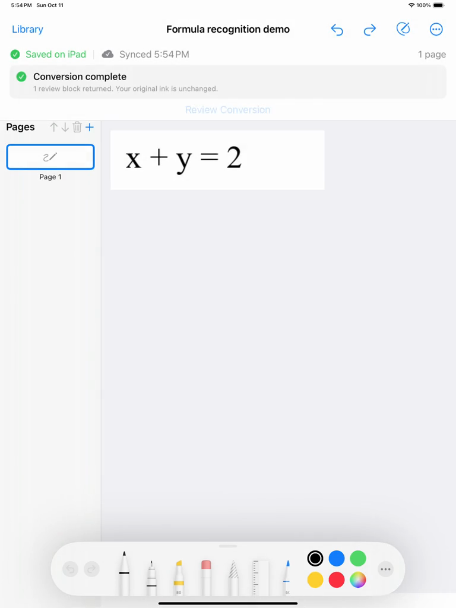
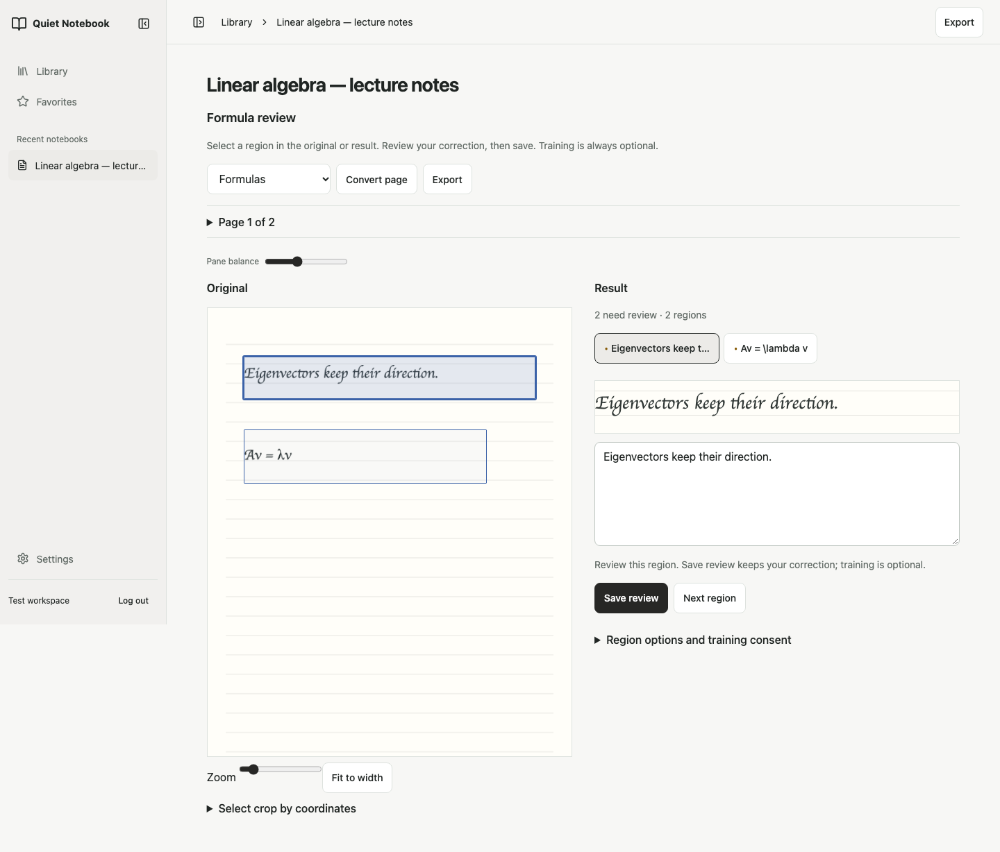
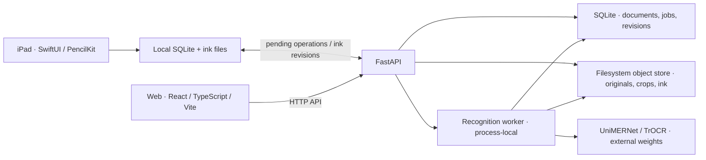

# Handwriting Notes Digitizer

An iPad and web app for turning handwritten notes and PDFs into reviewed text
and editable LaTeX while preserving the original source.

SwiftUI / PencilKit · React / TypeScript / Vite · FastAPI / PyTorch

[Demo details](demos/README.md) · [Engineering case study](docs/CASE_STUDY.md) ·
[Run locally](docs/GETTING_STARTED.md)

<table>
  <tr><th>iPad: recorded conversion demo</th><th>Web: Quiet Notebook workspace</th></tr>
  <tr>
    <td><a href="demos/demo-preview.png"></a></td>
    <td><a href="docs/release-evidence/ui-revamp/review-light-1440.png"></a></td>
  </tr>
</table>

The iPad demo uses a printed formula smoke fixture. The current web screenshot
uses synthetic lecture notes to show the redesigned workspace; the video predates
the redesign. [UI screenshots and validation](docs/release-evidence/UI_REVAMP_2026-10-14.md).

## The workflow

1. **Capture or import.** Create notebooks in the iPad client or import PDF,
   PNG, and JPEG notes. Retain the original files and page ink.
2. **Recognize and review.** Select prose or formula regions, run recognition,
   and compare predictions with their source. Correct text or LaTeX, reorder
   regions, and mark uncertain results for review.
3. **Save and export.** Reopen saved corrections and export the reviewed
   document as Markdown, LaTeX, or HTML. The web export pipeline also supports
   a controlled PDF.

The native client is currently named **Personalized Notes** in the app and
Xcode targets. It is the native interface to this same project, with a universal
iPhone/iPad target. Simulator checks do not establish physical-device readiness.

## Engineering highlights

- **Preserving notes through sync:** SQLite stores native edits locally, pending
  operations survive relaunch, and remote ink downloads recheck the local
  revision before installation so a new drawing is protected.
- **Review tied to its source:** database-backed recognition jobs use frozen
  crops and model provenance. Version-checked, immutable review revisions keep
  saved corrections and exports consistent.
- **Shared native and web boundaries:** OpenAPI, error-code, and ink contracts
  connect Swift and TypeScript clients to owner-scoped FastAPI services.
  Property, integration, and simulator tests cover recovery and isolation.

The project implements the application, synchronization, review/export pipeline,
model adapters, and training/evaluation tooling. The demonstrated recognition
uses pretrained **UniMERNet-small** for formulas and **TrOCR** for prose. The
custom compact formula model and legacy CRNN personalization are additional
research paths; their quality has not been established on representative notes.

## Architecture



PostgreSQL, Redis-backed rate limits, and encrypted SeaweedFS storage have an
optional [deployment profile](docs/PRODUCTION_PROFILE.md). The local production
stack passes its functional smoke checks; HTTPS, backup/restore and recognition
runtime acceptance remain. The recognition worker runs inside the API process.

## Current status

| Area | Evidence and remaining limits |
| --- | --- |
| Quiet Notebook UI | Library-first web workspace, System/Light/Dark appearance, responsive source-linked review and explicit save/export; browser accessibility/recovery and native simulator checks recorded in the [UI report](docs/release-evidence/UI_REVAMP_2026-10-14.md) |
| Web and iPad simulator conversion | Real-model recognition → source-linked review → save → reopen → Markdown export demonstrated locally |
| Offline storage and sync | Automated recovery, conflict, and exact-ink restoration coverage; complete live two-client interruption/conflict testing remains |
| Handwriting quality | Representative accuracy evaluation remains; the demo prose prediction needs human correction |
| Physical iPad / Apple Pencil | Hardware behavior, signing, accessibility, battery, and thermal testing remain |
| Personalization | Training/consent infrastructure exists; no demonstrated accuracy improvement |
| Deployment | SQLite plus the PostgreSQL/Redis/SeaweedFS production stack verified locally; encrypted storage and API workflow checks pass; internet deployment acceptance remains |

See the [maintained feature matrix](docs/FEATURE_STATUS_MATRIX.md),
[dated validation report](docs/release-evidence/REVIEW_FIXES_2026-10-11.md), and
[remaining work](TODO-2026-10-11.md). Automated test results establish behavior
at their recorded source revision; they do not measure handwriting accuracy.

## Run locally

For the web/API stack, install Docker with Compose and run from the repo root:

```bash
cp .env.example .env
HND_ENVIRONMENT=development FRONTEND_PORT=8080 make docker-up
```

Open **<http://localhost:8080/>**. Stop the attached logs with `Ctrl-C`, then run
`make docker-down` to shut down the services. Use these development settings
only for a local machine; browser sessions on a deployed service require HTTPS.

**A clean checkout contains no model weights.** The stack can start without
recognition models; model availability is shown by `/api/health`. Reproducing
the recorded inference requires separate model downloads and a compatible
runtime. The demonstrated setup uses macOS arm64 and an isolated Python 3.12
model environment; that environment is not bundled in the Linux Docker image.

[First-time setup and diagnostics](docs/GETTING_STARTED.md) ·
[Reproduce recognition / run the iPad app](docs/MODEL_AND_IPAD_SETUP.md) ·
[Testing guide](PROPERTY_TESTING.md)

## Repository map

| Directory | Responsibility |
| --- | --- |
| [`ios/`](ios/README.md) | SwiftUI/PencilKit app, SQLite store, sync client, share extension |
| [`frontend/`](frontend/README.md) | React/TypeScript Library, source-linked review, import, appearance and sync UI |
| `backend/` | FastAPI services, persistence, recognition jobs, model adapters, tests |
| `contracts/` | OpenAPI, error codes, canonical ink fixtures |
| `training/`, [`benchmarks/`](benchmarks/README.md) | Compact-model experiments and verified-prediction metrics |
| [`demos/`](demos/README.md) | Finished video and actual application screenshots |
| [`docs/`](docs/README.md) | Case study, setup, current status, evidence, and archived design history |
| `scripts/` | Diagnostics, model downloads, and contract checks |

[Documentation index](docs/README.md) · [MIT license](LICENSE) ·
[Third-party notices](THIRD_PARTY_NOTICES.md)
