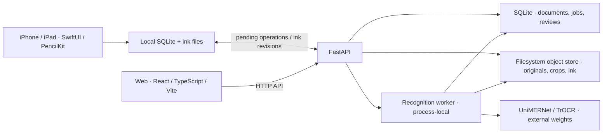

# Handwriting Notes Digitizer

Turn handwritten notes and PDFs into reviewed text and editable LaTeX while
keeping the original source. Web and native iPhone/iPad clients share a FastAPI
backend; the native app is currently named **Personalized Notes**.

SwiftUI / PencilKit · React / TypeScript / Vite · FastAPI / PyTorch

[Get started](docs/guides/getting-started.md) ·
[Architecture and case study](docs/reference/architecture.md) ·
[Documentation](docs/README.md) · [Status and roadmap](docs/STATUS.md) ·
[Contributing](CONTRIBUTING.md)


Current web UI, captured from the production build using synthetic lecture
notes and a mocked API. [More screenshots and the workflow](docs/guides/using-the-app.md).
These images demonstrate the interface; real-model validation is linked from
[status](docs/STATUS.md).

## What it does

- **Capture or import:** native notebooks and PencilKit ink, or PDF/PNG/JPEG imports.
- **Recognize and review:** prose and formula conversion with source-linked
  corrections, explicit saving, and review history.
- **Sync and export:** native local storage and pending operations; saved
  document exports as Markdown, LaTeX, HTML, and controlled PDF on the web.

## Architecture



The local stack uses SQLite and filesystem storage. The optional
[deployment profile](docs/guides/deployment.md) adds PostgreSQL, Redis rate
limits and encrypted SeaweedFS storage. Recognition runs inside the API process.

## Engineering highlights

- **Protect edits during sync.** Native edits persist locally; pending operations
  survive relaunch. Remote ink installation rechecks local revisions to protect
  a drawing made while a download is running.
- **Keep recognition and exports tied to their source.** Frozen crops and model
  provenance identify each prediction. Version-checked, immutable reviews keep
  saved corrections and exported snapshots consistent.
- **Connect native, web and ML boundaries.** OpenAPI, error codes and canonical
  ink fixtures define shared contracts. Property, integration and simulator
  tests cover recovery, ownership and serialization.

The project implements the clients, sync, review/export pipeline, model adapters
and training/evaluation tooling. Demonstrated recognition uses pretrained
UniMERNet-small and TrOCR; representative accuracy remains unmeasured.
The [engineering case study](docs/reference/architecture.md) explains the
tradeoffs and links each decision to implementation and regression tests.

## Run locally

Install Docker with Compose, then run from the repository root:

```bash
cp .env.example .env
HND_ENVIRONMENT=development FRONTEND_PORT=8080 make docker-up
```

Open <http://localhost:8080/>. Stop the attached logs with `Ctrl-C`, then run
`make docker-down` to stop the services. Data volumes are retained.
These settings are for local development; deployed browser sessions require HTTPS.

The application starts without recognition models. Follow
[first-time setup](docs/guides/getting-started.md) for local development and
[recognition and iPad setup](docs/guides/recognition-and-ipad.md) for separate
model downloads, the verified macOS runtime, and native installation.

## Inside the repository

| Area | Purpose |
| --- | --- |
| [Web](frontend/README.md) | React, TypeScript, Vite; Library, review, import and export |
| [Native](ios/README.md) | SwiftUI, PencilKit, local SQLite and sync |
| `backend/` | FastAPI services, persistence, recognition jobs and model adapters |
| `contracts/` | OpenAPI, error codes and canonical ink fixtures |
| `training/`, [benchmarks](benchmarks/README.md) | Optional model research and evaluation |
| [Documentation](docs/README.md) | Guides, reference, development and historical evidence |

[Architecture](docs/reference/architecture.md) ·
[Testing](docs/development/testing.md) · [MIT license](LICENSE) ·
[Third-party notices](THIRD_PARTY_NOTICES.md)
