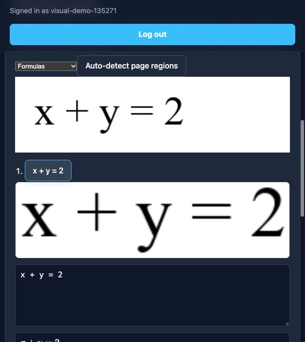
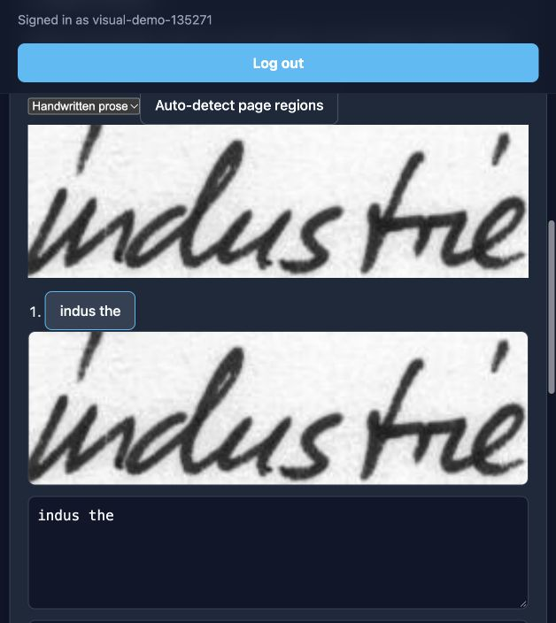

# Historical demo — October 11, 2026

> This recording and the screenshots below predate the Quiet Notebook UI redesign.
> See [the current interface and workflow](../docs/guides/using-the-app.md).

[Watch or download the 82-second demo](end-to-end-demo.mp4) — 1.3 MB, H.264,
768 × 1024, no audio. Browser playback reports 82.375 seconds; the older
acceptance report called it 84 seconds. The finished video is included in the repository so this
link works with the source checkout. The larger raw recording remains local.

## What the recording shows

The first part is an actual iPad simulator recording against the local backend
and installed UniMERNet/TrOCR models: sign-in → restore library → formula and
prose conversion → source-linked review → save → Markdown sharing → reopen.
The journey was driven by the opt-in `LiveConversionDemoUITests` acceptance
test. Recognition output was not substituted with a test engine; only startup
and final idle time were trimmed.

The last twelve seconds show labeled website screenshots, not a continuous
browser recording. A formula correction saved on the website also appears in
the native review.

## Website review

| Source and saved formula correction | Handwriting source and raw prose prediction |
| --- | --- |
|  |  |

The formula review was corrected to `x + y = 2`. The prose prediction `indus the`
is inaccurate and needs human correction. Saving that prediction in the test
verifies persistence and export; it does not certify the transcription.

## Scope of the evidence

Recorded October 11, 2026 on an iPad Pro simulator, iOS 18.6. The formula input
is a generated **printed** fixture; the prose input is a public IAM-derived OCR
fixture, not an independent accuracy holdout. The recording demonstrates
working inference and review/export integration. Physical Apple Pencil behavior,
representative handwriting quality, personalization improvement, and the full
two-device interruption/conflict journey remain unverified.

- [Recorded local acceptance report](../docs/release-evidence/END_TO_END_LOCAL_2026-10-11.md)
- [Model and recording provenance](../docs/release-evidence/END_TO_END_LOCAL_2026-10-11.json)
- [Current feature status](../docs/STATUS.md)
- [Media and third-party boundaries](../THIRD_PARTY_NOTICES.md)
- [Back to the project](../README.md)
