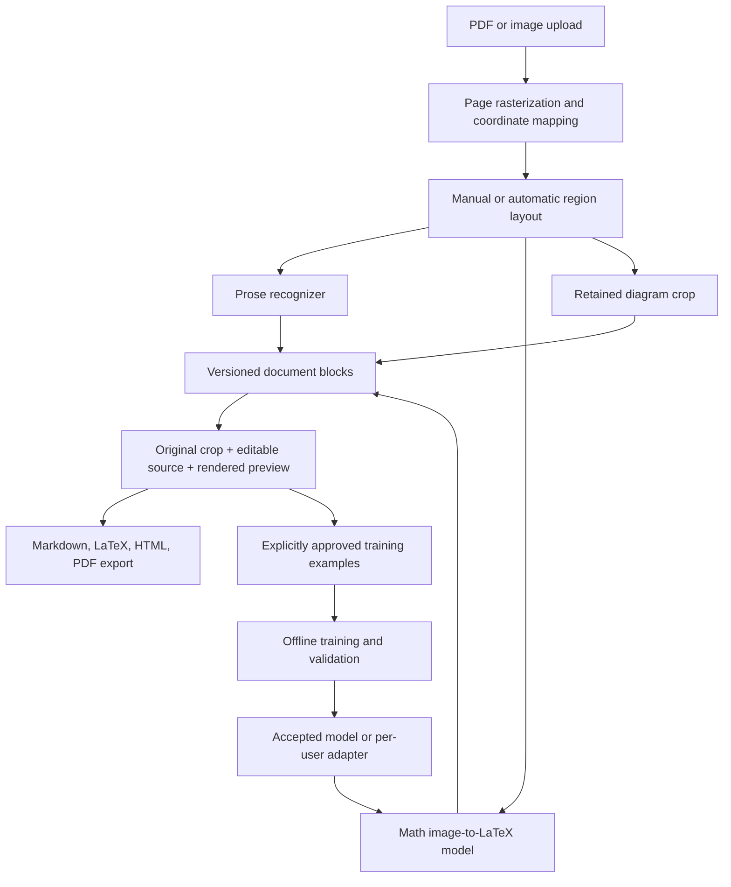

# Math notes to LaTeX: implementation and research plan

Prepared September 10, 2026, from repository inspection and primary research/model documentation. Models have not been downloaded, trained, or benchmarked on the user's notes or hardware. Estimates below are planning assumptions, not measured performance.

## 1. Product direction

Build a PDF-first application that converts handwritten course notes into an editable document containing prose, LaTeX mathematics, and retained figures. Every recognized block stays linked to its original crop. Users correct uncertain output, save revisions, and optionally contribute reviewed examples to personalization.

Confirmed requirements:

- Input is mainly PDF exports from an iPad notes app; photographs and images also matter.
- Notes contain mathematical symbols and difficult handwriting.
- Output should be pleasant to read and available as LaTeX or another portable format.
- The project should demonstrate substantial PyTorch and machine learning engineering work.
- Available hardware includes an RTX 3060 with 12 GB VRAM, RTX 3070 with 8 GB, and Ryzen 7840U laptop with integrated graphics and 64 GB system RAM.
- Free cloud GPUs and downloadable pretrained weights are acceptable options.

Assume English prose and an initial calculus/linear-algebra symbol set until actual samples establish the course coverage. Include fractions, exponents, subscripts, roots, integrals, sums, Greek letters, matrices, and aligned derivations. Preserve diagrams as images initially. Recognize what was written; do not silently solve equations, correct the student's mathematics, or invent illegible symbols. Expose ambiguity as a review task.

The first useful release should support manually selected formula crops within a multipage PDF. Automatic page layout should follow once crop recognition and editing work. This gives a useful product while keeping segmentation errors separate from recognition errors.

## 2. Why the current recognizer needs to change

The current model is a CNN + bidirectional LSTM + CTC recognizer for English handwriting lines. Its alphabet in `backend/app/ml/htr_config.py` omits `=`, backslash, braces, many operators, and Greek symbols. `encode_text()` in `backend/app/ml/train_base.py` silently drops unsupported characters. Its CNN reduces image height to one feature row before decoding across width. Fractions, matrices, and nested scripts need a model that preserves two-dimensional relationships and emits structured LaTeX.

The existing adapter trains a replacement linear classifier; it does not add mathematical layout understanding. Extending the alphabet alone would not resolve the structural problem.

The checked-in IAM manifest contains placeholder examples, and the documented fallback images are random noise. Training that default path does not create useful handwriting recognition. The worker also evaluates general accuracy on synthetic noise paired with sentences. This exercises plumbing but cannot justify claims about handwriting accuracy or regression prevention.

Keep authentication, ownership scoping, object storage, migrations, document history, correction UI concepts, and training-job infrastructure. Introduce a new math recognition backend, document representation, and real evaluation pipeline.

## 3. Pretrained weights and model choices

These are candidate models to benchmark, not a claim that one will be best on this user's notes.

| Candidate | Role in this project | Availability and limits |
|---|---|---|
| UniMERNet small/tiny | First compact image-to-LaTeX baseline; practical starting point for adaptation | Official project publishes PyTorch training code and small/tiny/base checkpoints. Formula crops, not complete note documents. [Official repo](https://github.com/opendatalab/UniMERNet), [small weights](https://huggingface.co/wanderkid/unimernet_small). |
| Uni-MuMER Qwen3.5-2B | Stronger handwriting-specific comparison model; optional later QLoRA experiment | Author-linked checkpoint is available. Requires a newer software environment than this repo; start with inference and measure memory before committing to training. [Weights](https://huggingface.co/phxember/Uni-MuMER-Qwen3.5-2B). |
| Uni-MuMER Qwen2.5-VL-3B | Alternative VLM baseline if newer architecture support complicates setup | Available from the authors' model collection. Larger than the 2B candidate. [Weights](https://huggingface.co/phxember/Uni-MuMER-Qwen2.5-VL-3B), [project](https://github.com/BFlameSwift/Uni-MuMER). |
| TAMER | Structure-aware research reference and possible compact-model baseline | Authors provide training code and CROHME/HME100K checkpoints. Legacy Python/PyTorch dependencies need isolation or a tested port. [Official repo](https://github.com/qingzhenduyu/TAMER). |
| CoMER | Reference for an independently implemented coverage experiment | PyTorch implementation and checkpoint are published. Repository is archived; treat it as a research reference. [Official repo](https://github.com/Green-Wood/CoMER). |
| TrOCR handwritten | Prose-only comparison on cropped handwriting lines | Pretrained on IAM; not the math parser. [Microsoft checkpoint](https://huggingface.co/microsoft/trocr-base-handwritten). |
| GLM-OCR / Pix2Text | Optional complete-document baselines | Useful to compare page extraction with our modular pipeline; document benchmarks do not establish performance on messy personal notes. [GLM-OCR](https://github.com/zai-org/GLM-OCR), [Pix2Text](https://github.com/breezedeus/Pix2Text). |
| PP-FormulaNet Plus | Optional external formula benchmark | PaddleOCR publishes training/inference weights. Useful comparison, but a Paddle-based integration contributes less directly to the PyTorch goal. [Official documentation](https://github.com/PaddlePaddle/PaddleOCR/blob/main/docs/version3.x/pipeline_usage/formula_recognition.en.md). |

Recommended shortlist: UniMERNet-small, Uni-MuMER-2B, and one compact research model. Benchmark these before integrating additional systems. Start the application integration with UniMERNet-small; switch the default only when the user's development set supports that decision.

### How to obtain weights

The available checkpoints are downloadable without paying for training. Download a complete model snapshot, including tokenizer, configuration, and processor files. An example in a separate model environment is:

```python
from huggingface_hub import snapshot_download

snapshot_download(
    repo_id="wanderkid/unimernet_small",
    local_dir="models/unimernet_small",
)
```

This only downloads files. Use the upstream inference implementation/configuration to load them. For reproducibility, resolve the model's current commit during setup, record it, and thereafter pass that exact commit as `revision`. Hugging Face documents snapshot and revision downloads in its [download guide](https://huggingface.co/docs/huggingface_hub/guides/download).

Do not rename downloaded weights to `base_model.pt`. This repo's loader expects a particular CRNN architecture and a checkpoint containing `state_dict` and `model_config`; unrelated architectures and tokenizers are incompatible. Add a recognizer interface and backend-specific loaders.

A model artifact manifest should record model ID, source URL, upstream code commit, weight revision/hash, tokenizer hash, processor configuration, license, supported inputs, dtype, and benchmark version. Weights stay outside ordinary Git. Verify each model and dataset's own terms; a repository's code license does not automatically settle its data or checkpoint permissions.

### Papers worth studying

| Paper | What to learn or implement |
|---|---|
| [BTTR, ICDAR 2021](https://arxiv.org/abs/2105.02412) | Image-to-LaTeX Transformer baseline and bidirectional training. Useful foundation before complicated extensions. |
| [CoMER, ECCV 2022](https://arxiv.org/abs/2207.04410) | Coverage-aware attention to address missing or repeated symbols. Good controlled PyTorch ablation. |
| [UniMERNet, 2024](https://arxiv.org/abs/2404.15254) | Practical formula recognition across varied image sources. Reference for pretrained integration. |
| [TAMER, AAAI 2025](https://arxiv.org/abs/2408.08578) | Tree-aware structural supervision. Potential extension if nested-expression errors dominate. |
| [Uni-MuMER, NeurIPS 2025](https://arxiv.org/abs/2505.23566) | Domain adaptation of VLMs using structure, errors, and symbol counting. Full published training is not the initial single-GPU plan. |
| [MathWriting, 2024](https://arxiv.org/abs/2404.10690) | Dataset design, normalization, digital ink, and offline rasterization. |
| [Character Detection Matching, CVPR 2025](https://arxiv.org/abs/2409.03643) | Evaluate rendered formula structure alongside string metrics; equivalent LaTeX strings can differ. |

Study BTTR/CoMER for implementation fundamentals, UniMERNet for the first usable baseline, then TAMER or Uni-MuMER according to measured errors. Reproduce one focused extension well rather than attempting every paper.

## 4. Hardware and free compute

Use the RTX 3060 12 GB as the default training device because its greater memory provides more room for image features, decoder activations, and batch size. The 3070 can be a second inference or experiment target. Do not assume their memory can be added together; ordinary data-parallel training replicates the model on each device.

The 7840U/64 GB laptop is useful for PDF processing, labeling, dataset preparation, the web app, and CPU inference experiments. Its system RAM is not equivalent to dedicated CUDA VRAM. Do not make integrated-GPU acceleration a critical dependency.

These are proposed starting configurations to profile:

| Workload | Initial setup |
|---|---|
| UniMERNet-small inference | One crop per batch, upstream preprocessing, mixed precision only after output parity checks |
| Compact custom model | 10–30M parameter target, microbatch 2–4, accumulation to 16–32 effective examples, variable-resolution buckets |
| UniMERNet adaptation | Freeze encoder first; train selected decoder adapters. Start microbatch 1–2 and measure backward-pass memory |
| Uni-MuMER inference | Batch 1; consider supported 4-bit loading if needed. Bound image pixels and generated length |
| Optional VLM QLoRA | Rank 8 or 16, microbatch 1, gradient checkpointing, prompt/padding loss masking; proceed only after a successful memory pilot |

Fitting quantized inference does not prove training will fit. Start with 100 optimization steps and record peak allocated/reserved VRAM, speed, and loss before scheduling a long run. A 2B VLM is optional; the compact-model path must remain viable if it is too slow or memory constrained. Use FP16 plus gradient scaling when appropriate; check hardware support before selecting BF16. [PyTorch AMP guide](https://docs.pytorch.org/tutorials/recipes/recipes/amp_recipe.html), [quantization documentation](https://huggingface.co/docs/transformers/quantization/bitsandbytes).

### Free cloud options

| Option | Verified public guidance | Planned use |
|---|---|---|
| Google Colab free | GPU type and limits vary. Free runtimes can last at most 12 hours depending on usage and availability; no guaranteed GPU allocation. [FAQ](https://research.google.com/colaboratory/faq.html) | Short pretrained-model trials and resumable training experiments |
| Kaggle Notebooks | Official GPU guidance describes a weekly quota of 30 hours, sometimes higher with availability; account dashboard is authoritative. [GPU guidance](https://www.kaggle.com/docs/efficient-gpu-usage) | Scheduled baseline/ablation runs and portable notebooks |
| Amazon SageMaker Studio Lab | Free service; documentation states up to 4 GPU hours per session and per 24-hour period. [Service](https://docs.aws.amazon.com/sagemaker/latest/dg/studio-lab.html), [limits](https://docs.aws.amazon.com/sagemaker/latest/dg/studio-lab-overview.html) | Short checkpointed runs if access is available |
| Lightning AI | Public documentation advertises monthly free credits; GPU hours depend on instance rates and interruption conditions. [Billing](https://lightning.ai/docs/overview/faq/billing), [pricing](https://lightning.ai/pricing/) | Optional supplementary experiments; inspect current account allowance |

Availability is not guaranteed and free-tier terms can change. Use local training as the dependable path. A university lab or course compute allocation is also worth checking; availability has not been established here.

For every cloud notebook: install a pinned environment, download only required data, copy data to local runtime storage for training, save checkpoints periodically to durable private storage, and retain model/optimizer/scheduler/scaler/RNG/config/split states. Notebook cells should call the same training CLI as local runs. Do not keep the only checkpoint on an ephemeral VM. Treat free notebooks as experiment environments, not the deployed application's permanent server.

## 5. Data and evaluation before training

### Public data

Use [MathWriting](https://github.com/google-research/google-research/tree/master/mathwriting) as the primary development corpus. It provides human-written and synthetic digital inks; rasterize InkML strokes for the image model. Use `normalizedLabel` as directed by the dataset documentation, retaining raw labels too. The corpus provides roughly 230k human training samples plus a large synthetic set. Its data license is CC BY-NC-SA 4.0; code has a separate Apache license. Begin with a stratified 10k–30k training subset, then scale only after the loader and learning curves are sound. [Dataset format](https://github.com/google-research/google-research/blob/master/mathwriting/archive_readme.md).

Preserve official splits. MathWriting does not publish writer IDs, and its split design includes both writer and expression considerations; do not describe it as wholly writer-disjoint. Split custom augmentations after assigning their source sample, so every rendering of one ink remains in one partition.

Use [HME100K](https://github.com/Phymond/HME100K) as a complementary source of photographed handwritten expressions. Inspect access/terms from the official source rather than assuming a third-party mirror grants reuse permission. Its associated [SAN paper](https://openaccess.thecvf.com/content/CVPR2022/html/Yuan_Syntax-Aware_Network_for_Handwritten_Mathematical_Expression_Recognition_CVPR_2022_paper.html) is useful for understanding the task. Add CROHME as a research comparison using the split/evaluator associated with the chosen paper. Use UniMER-Test only as evaluation data; it must not feed tuning or personalization.

Public benchmark performance of a pretrained model is contextual evidence: its pretraining may overlap relevant corpora. Document known/unknown training provenance and do not call a benchmark unseen unless that is established. The user's later-collected private notes should be the decisive product test.

### Personal notes dataset

Start with 30–50 real pages spanning several note-taking sessions and difficulty levels. Create 200–500 carefully labeled formula crops plus representative prose regions. Those are initial collection targets, not a promise that this amount guarantees useful adaptation.

Assign whole pages/documents to approximately 60% train, 20% development, and 20% final test before cropping. Keep near-duplicate equations and exports together. Prefer a chronological final test from later lectures. If other writers contribute with permission, maintain a separate writer-held-out test. A single-writer experiment measures personal adaptation, not general handwriting performance.

Record source document/page IDs, crop coordinates, original image hash, capture type, raw/canonical LaTeX, reviewer state, and difficulty tags. Tags should include small scripts, nested fractions, matrices, long derivations, lined paper, shadows, blur, crossed-out work, and ambiguous symbols. Label from the original crop rather than accepting a model's suggestion as ground truth. Mark genuinely unreadable regions explicitly.

A useful manifest record contains:

```json
{
  "sample_id": "notes-session-03-page-02-region-07",
  "source_document_id": "notes-session-03",
  "page_index": 1,
  "bbox": [120, 280, 740, 190],
  "coordinate_space": "page-raster-v1",
  "content_type": "math_display",
  "latex": "\\frac{d}{dx}x^2=2x",
  "split": "train",
  "capture_type": "ipad_pdf",
  "review_status": "verified"
}
```

### Evaluation contract

| Metric | Why it matters |
|---|---|
| Normalized expression exact match | Strict whole-formula success after documented syntactic normalization |
| LaTeX token error rate | Partial credit and diagnosis of command/brace/operator errors |
| CDM and visual checks | Compare rendered prediction and rendered reference, accounting for alternate notation |
| Critical symbol/structure errors | Explicitly track missing minus signs, inequality direction, exponents, indices, matrix shape |
| Render success and truncation rate | Detect malformed or incomplete outputs; renderability alone does not imply correctness |
| Prose CER/WER | Measure prose independently of mathematical LaTeX |
| Layout recall and end-to-end page accuracy | Detect omitted regions and reading-order errors; count missed detections as failures |
| Human correction time | The main product measure: time to a correct, readable note |
| p50/p95 latency and peak memory | Establish actual usability on the 3060 and CPU |

CDM renders both predicted and reference LaTeX; it does not directly compare the original handwriting photo with a typeset formula. Do not use raw image similarity between handwriting and typeset output as ground truth. Do not normalize away real mathematical distinctions or use algebraic equivalence as the sole transcription metric. [CDM paper](https://arxiv.org/abs/2409.03643).

Evaluate crop recognition with manually verified boxes first, then the complete page pipeline separately. Keep blank, unreadable, failed, and truncated examples in denominators. Use validation for model selection and adapter acceptance; reserve the final test for release evaluation. Report paired bootstrap uncertainty grouped by page for personal-note comparisons. A few examples or a single best seed cannot support a broad improvement claim.

## 6. Target application architecture



### Input handling

Add a PDF import endpoint that stores the original and creates ordered page records. Rasterize at an initial 200–300 DPI with configurable pixel limits. Normalize EXIF orientation for photos, flatten transparency against a known background, and offer rotation/perspective correction. Keep an unmodified original. Do not force the old 32-pixel line preprocessing on formula models; use each model's own processor.

Store the PDF-to-raster and any subsequent rotation/crop transforms. Region coordinates must identify their coordinate space and page version. An iPad PDF may contain vector paths, images, or text; do not assume it retains pen timing or recoverable stroke order. Stroke-based modeling is a separate future feature only if the input format actually exposes strokes.

Bound file size, page count, decoded pixels, and parsing time. Reject or explain password-protected/corrupt PDFs. Process pages progressively with cancellation and restart support.

### Persistent document representation

Introduce a document schema instead of deriving all content from `RecognizedWord` rows:

- `Document`: owner, title, ordered pages, active revision.
- `Page`: original asset, raster asset, dimensions, transforms, page order.
- `Region`: stable ID, page ID, bounding box, type, order, revision.
- `Prediction`: region ID, engine/version, raw output, alternatives, score, status, timings.
- `ReviewRevision`: immutable corrected text/LaTeX, exclusion flag, crop revision, author/time.
- `TrainingExample`: exact reviewed revision and crop hash, consent/eligibility, dataset split.
- `ModelArtifact`: backend identity, tokenizer/processor hashes, base/adapter versions, evaluation provenance.

Supported blocks should include text, display math, mixed inline content, and retained figures. For a first release, mixed lines may use ordered text/math child spans manually split by the reviewer. Later, predict those spans automatically. Formula regions must contain complete expressions, including fraction bars, limits, and scripts.

Prediction updates must never silently replace reviewed content. Reruns create candidate revisions that can be compared and accepted. Reordering, edits, and `Not text` state persist across reloads and all export formats.

### Model boundary and jobs

Define an engine interface accepting an image/crop plus explicit model settings and returning candidates with LaTeX/text, raw score, truncation flag, and provenance. Batch where useful, but do not interpret an average token probability as calibrated expression correctness.

Keep ML workers separate from FastAPI request handling. Proposed API:

- `POST /documents/import`: accept PDF/image and return document/job IDs.
- `GET /jobs/{id}` and optional SSE event stream: progress and errors.
- `POST /pages/{id}/recognition-jobs`: submit regions or automatic layout.
- `PATCH /regions/{id}/review`: persist a version-checked correction.
- `POST /documents/{id}/exports`: export a specified reviewed revision.
- `POST /personalization/runs`: request training from a reviewed snapshot.

Every operation remains owner-scoped. Workers own their database sessions. Jobs use bounded concurrency, database-backed state, retry semantics, and stale-job recovery. Start with one GPU worker. A timeout must either stop a supervised worker process or leave work tracked as running with a result deadline; `Future.cancel()` does not stop inference already running in a thread.

### Review and export

Provide a three-part view: original crop, editable LaTeX/prose, rendered output. Include keyboard navigation, crop adjustments, region reordering, undo, and explicit unresolved markers. Add alternative predictions only when they help resolve a concrete ambiguity. Preserve raw output for debugging.

Use KaTeX with untrusted input settings for supported math, and show unsupported commands as review errors. [KaTeX options](https://katex.org/docs/options.html). Primary export is Markdown with math delimiters and asset references; also produce standalone HTML and a `.tex` bundle with required assets. Generate a real PDF from the same reviewed revision using a controlled rendering process. If TeX compilation is used, isolate it, disable shell escape/network access, and impose time/resource limits. Rendering success is a formatting check, not proof of mathematical accuracy.

## 7. Fix the current problems first

| Priority | Problem and implementation | Acceptance test |
|---|---|---|
| P0 | Replace the general evaluation noise path in `training_worker.py` with verified image-label pairs. Restrict synthetic fixtures to explicit test mode; disable adapter promotion when valid evaluation is unavailable. | Missing/placeholder evaluation prevents promotion; a known degraded candidate is rejected on real fixtures. |
| P0 | Remove silent untrained/corrupt-model fallback from normal recognition. Report unavailable capability until an artifact loads and passes a small inference check. Health must report the loaded model, not file existence. | Missing, corrupt, and incompatible artifacts never report trained recognition. |
| P1 | Replace the low-confidence warning's interpolated `innerHTML` in `editor.ts` with text nodes. Audit other dynamic HTML sinks. | A recognized string containing markup appears literally and creates no elements or handlers. |
| P1 | Fix PDF-after-edit export in `main.ts`/`editor.ts`. Persist reviewed content and route all formats through one export contract; return PDF bytes as `application/pdf`. | Edit a line, exclude another, reload, then export: preview/Markdown/PDF agree and the PDF opens. |
| P1 | Make recognition retries idempotent. Initially prevent accidental repeated append; longer term use immutable prediction runs with one active result. Protect user edits. | Sequential retries and simultaneous submissions cannot duplicate active content or erase corrections. |
| P1 | Persist line-level review and exclusion state explicitly. Current line edits largely live in frontend maps, and the correction helper updates individual matched words. | Save, refresh, reopen history, and export without losing line text or excluded regions. |
| P1 | Pass `recognition_timeout_seconds` to both recognition API paths, then replace per-request thread executors with supervised jobs. | Non-default settings affect both paths; repeated timeouts cannot create unlimited untracked work. |
| P1 | Handle duplicate-email and concurrent-registration integrity errors in `auth_api.py`; rollback and return a controlled conflict. | Same email/different username and simultaneous duplicate requests never produce an uncaught 500. |
| P1 | Replace `metric_a or metric_b` fallback in `personalization_service.py` with explicit `None` checks. Zero error is a valid metric. | A report with `0.0` CER/WER remains valid rather than becoming unavailable. |
| P1 | Reject unsupported training labels rather than silently stripping characters. New math tokenization must round-trip all accepted LaTeX. | Unsupported labels fail visibly; fractions, Greek commands, braces, and operators survive tokenization. |
| P2 | Separate CPU app, CUDA training, and newer VLM dependency environments. Current requirements pin CPU-only torch wheels. Forward intended Compose settings, including environment mode. | Clean installs and a CUDA forward/backward smoke test on the NVIDIA machine; CPU deployment still works. |

For existing duplicate recognition rows, do not blindly deduplicate: corrections may make rows differ. Back up the database, report conflicting groups, migrate recoverable content conservatively, and retain ambiguity for review. Use additive migrations and test upgrades from an existing database.

The earlier review could not run the suites because backend dependencies were absent and npm downloads failed. Establish CI and a reproducible environment before treating current tests as passing. Add focused regressions for the behaviors above, plus an end-to-end PDF-to-reviewed-export test. Keep heavyweight accuracy benchmarks separate from fast unit tests.

## 8. PyTorch experiment that demonstrates depth

Primary research question: **Can limited reviewed examples of one person's handwriting reduce transcription errors on later notes, without materially harming a separate general-math validation set?** A second question, only after the first pipeline works, is whether coverage-aware decoding reduces omitted/repeated symbols at similar compute cost.

### Two bounded model tracks

Track A is the practical adaptation path. Start from UniMERNet-small, record a frozen baseline, then compare decoder-only fine-tuning and low-rank adaptation. Freeze the visual encoder initially. If error analysis shows visual-domain failure, test selected later encoder layers as one additional experiment. Do not reuse the old CRNN classifier adapter for this architecture. Bind every new adapter to a base-model and tokenizer hash. [LoRA documentation](https://huggingface.co/docs/peft/developer_guides/lora).

Track B is the learning/research artifact. Implement a compact image-to-LaTeX model in native PyTorch, using the papers as references and clearly crediting borrowed ideas. It need not outperform a billion-parameter model to demonstrate skill. Its value is a reproducible architecture, honest comparison, and explained errors.

Proposed compact architecture:

1. CNN visual encoder retaining a two-dimensional feature grid.
2. Project features into a 256-dimensional representation; add two-dimensional positional information and valid-pixel masks.
3. Four-layer Transformer decoder, initially four attention heads, with causal self-attention and cross-attention to image features.
4. LaTeX token vocabulary containing commands, braces, digits, operators, letters, BOS/EOS/PAD, and explicit unsupported-token handling.
5. Teacher-forced cross-entropy with padding masked out. Include EOS in the target and shift decoder inputs exactly once.
6. Greedy decoding first; bounded beam search second. Track maximum-length termination as truncation, not successful completion.
7. Add a CoMER-inspired coverage mechanism as a separate variant, or a TAMER-inspired structural auxiliary loss if structural errors dominate. Do not add both at once.

Initial crop buckets could target heights of 96, 128, and 192 pixels with widths capped per bucket. These are proposed experiments, not pretrained processor replacements. Retain aspect ratio and margins. Complex fractions may require larger images; route outliers to a larger bucket rather than silently squashing or truncating them. Mask padded image regions during cross-attention. Establish a tiny-subset overfit test before large training.

### Training implementation

Implement and explain:

- Dataset parsing, reproducible InkML rasterization, and image/label validation.
- Length/resolution bucketing, dynamic padding, and worker-seeded data loading.
- Mixed precision, gradient accumulation, clipping, and scheduler stepping per optimizer update.
- Correct loss normalization over valid tokens, including unequal microbatches.
- Optimizer groups, frozen-parameter checks, gradient checks, and train/eval mode handling.
- Checkpoints containing weights, tokenizer/config, optimizer, scheduler, scaler, RNG state, and data position/epoch.
- Early stopping on development recognition metrics, not training loss alone.
- Profiling for decoder latency, padding overhead, CPU data stalls, and peak CUDA memory.

Do not report cross-hardware bitwise reproducibility. Document seeds and tolerances; compare repeated runs where affordable. Test uninterrupted versus resumed runs under the same environment.

For LoRA, a small independently implemented linear wrapper can demonstrate the update `W + (alpha/r) BA`. Test that zero-initialized updates reproduce the frozen model, gradients flow only into enabled trainable tensors, and merging preserves outputs within tolerance. Compare against a trusted implementation. This is optional if it distracts from the main compact model.

### Experiment matrix

| Experiment | Changes | Purpose |
|---|---|---|
| E0 | Frozen UniMERNet-small | Practical pretrained baseline |
| E1 | Frozen Uni-MuMER-2B | Larger-model quality/latency comparison |
| E2 | E0 + personal decoder adaptation | Test whether personal labels help |
| E3 | E0 + LoRA, matched data/budget | Compare adaptation efficiency |
| E4 | Compact CNN/Transformer trained on public math data | Demonstrate native PyTorch implementation |
| E5 | E4 + coverage, matched data/budget | Isolate omitted/repeated-symbol improvement |
| E6, optional | Personalization with random versus uncertainty-based sample selection | Measure improvement per reviewed example |

Run the first four only if schedule is tight. If implementation depth is the main interview objective, prioritize E4/E5 over extra VLM tuning. Keep a one-seed pilot, then repeat the most informative comparison with up to three seeds. Maintain the same data budget, preprocessing, decoding policy, and evaluation protocol within each claimed ablation.

Plot personal adaptation at 0, 25, 50, 100, and 200 reviewed examples if data permits. Evaluate each point on development data; use the untouched final test only for the chosen configuration. Compare candidates against both the current deployed adapter and the frozen base. Keep a modest public-data replay component as a tested option, not an assumed improvement.

Reject promotion if evidence is insufficient, user validation worsens, or general math validation exceeds a declared tolerance. Save rejected candidates and metadata for analysis. Keep the existing adapter available for rollback. Repeated use of a promotion validation set creates selection pressure, so retain a separate final audit set and periodically refresh validation with new sessions.

### Calibrated review

Begin with heuristic review signals: invalid LaTeX, truncation, low sequence score, and model disagreement. Learn a validation-calibrated error score only once enough labeled examples exist. Evaluate risk versus coverage: as more uncertain examples are referred to the user, how many errors remain in accepted predictions? Do not label softmax confidence as a guaranteed probability of correctness.

## 9. Implementation sequence and completion gates

Estimated effort for one developer: a useful vertical slice in roughly 2–3 focused weeks; a credible research portfolio in roughly 8–12 focused weeks, or longer part-time. Dataset labeling, debugging old research dependencies, and GPU experiments are the largest uncertainties. Gate each phase by behavior and evidence rather than calendar dates.

| Phase | Work | Completion gate |
|---|---|---|
| 0: Stabilize, 3–5 days | Fix unsafe HTML, export inconsistency, repeated recognition, configuration, registration, zero-metric handling; disable bogus evaluation and untrained inference; establish tests | Regressions pass and runtime state is truthful |
| 1: Data and baseline, 4–7 days | Label development crops, reserve final test, isolate model environments, run the shortlist | Versioned baseline report with errors, latency, memory, and provenance |
| 2: PDF vertical slice, 5–8 days | PDF page import, manual complete-expression selection, engine adapter, persisted review, Markdown/LaTeX/HTML/PDF | Real multipage notes can be uploaded, corrected, reopened, and exported consistently |
| 3: Page automation, 5–10 days | Prose/math/figure regions, reading order, manual split/merge, job recovery | Region recall and complete-page correction time measured; missing regions remain visible |
| 4: Adaptation, 1–2 weeks | Real dataset loader, resumable training, E0–E3, valid promotion gate | Measured personalization curve and rollback demonstration |
| 5: PyTorch research, 2–3 weeks | Compact model, E4/E5, profiling and ablation | Reproducible results with model/data cards and failure analysis |
| 6: Packaging, 3–5 days | Portable Colab/Kaggle launch notebooks, setup checks, evaluation report, demo recording | A reviewer can reproduce a sample inference and small training run |

Product success targets, proposals to validate after baselines:

- Save/reload/export retains 100% of reviewed content, order, and exclusions.
- No silent success for missing models, invalid outputs, missing regions, or truncated generation.
- Demonstrate lower median correction time than manually transcribing comparable notes; use counterbalanced note sets to reduce learning bias.
- Aim for a meaningful reduction in personal-note token errors, for example 15–20% relative, without an unacceptable general-validation regression. Treat this as a target, never a promised result.
- Report all observed latency/memory figures on specified hardware, including model-loading versus warmed inference time.

If pretrained recognition is already strong, focus adaptation on difficult handwriting and review efficiency. If it is weak on target notation, collect targeted verified examples and fix crop/layout failures before increasing model size. If custom training underperforms, publish the negative result with an error analysis and retain the pretrained backend for usability.

## 10. Suggested repository organization

Proposed additions, not existing commands or files:

```text
backend/app/ml/backends/           # common interface; UniMERNet, VLM, prose adapters
backend/app/ml/math/               # tokenizer, encoder, decoder, coverage, decoding
backend/app/services/pdf_import.py
backend/app/services/document_review.py
backend/app/services/jobs.py
backend/app/services/document_export.py
backend/app/data/models.py         # additive document/prediction/review schema
training/                         # CLI, dataset loaders, losses, checkpointing
training/configs/                 # compact model and adaptation experiments
benchmarks/                       # manifests, metrics, evaluation runner
notebooks/                        # thin Colab/Kaggle launchers
frontend/src/modules/mathEditor.ts
frontend/src/modules/pageViewer.ts
frontend/src/modules/reviewQueue.ts
```

Separate application requirements from CUDA training and optional VLM requirements. Lock each tested environment after a successful install, model-load, and backward-pass test. The current CPU-only requirements cannot serve as the CUDA training lock. Follow the official [PyTorch installation selector](https://pytorch.org/get-started/locally/) for the NVIDIA machine, then pin the verified package set. Keep newer VLM dependencies isolated from the existing backend until compatibility is tested.

Add CI jobs for frontend type checking/build/tests, backend unit and migration tests, document revision behavior, and export consistency. GPU accuracy benchmarks should run on demand with downloadable licensed data; CI must not silently replace missing accuracy data with noise.

## 11. What to show interviewers

Present a complete engineering argument with artifacts:

1. A real PDF containing difficult equations and prose, linked to the reviewed output.
2. An explanation of why a line CTC model was inadequate for this input.
3. A PyTorch model diagram, tensor shapes, masking strategy, training objective, and decoding procedure you can explain and modify.
4. A baseline versus adaptation comparison on later, held-out notes, with uncertainty and failure examples.
5. A controlled coverage or structure ablation, including negative results.
6. A memory/latency profile showing an actual optimization and its accuracy tradeoff.
7. A portable checkpoint and notebook that reproduce inference and resume a short training run.
8. Model/data cards describing source weights, personal contributions, licenses, limitations, and evaluation contamination risks.

Describe results only after measurement. A future resume bullet could be: “Built a PyTorch handwriting-to-LaTeX pipeline for multipage notes; reduced held-out transcription errors by X% through evaluated personalization while using Y GB VRAM.” Fill in X and Y from saved experiment results, including dataset size and the exact baseline. Avoid claiming a novel architecture when the contribution is integration or adaptation of published work.

First three implementation deliverables: repair the reliability/evaluation issues, establish a real personal-note benchmark, and ship the PDF-to-reviewed-LaTeX vertical slice. Larger models, automatic layout, and research extensions should build on those foundations.
