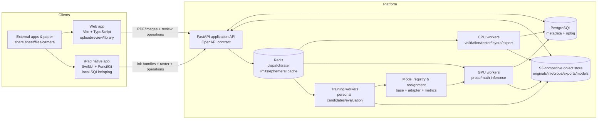

# Personalized handwriting conversion platform: implementation plan

> **Historical document.** Retained for design rationale and development history.
> Its checkboxes, machine paths, and capability statements describe an earlier
> stage; use the [current status](../FEATURE_STATUS_MATRIX.md),
> [active remaining work](../../TODO-2026-10-11.md), and
> [setup guide](../GETTING_STARTED.md) for the maintained project state.

Prepared September 11, 2026 from a repository audit, successful local test runs, runtime diagnostics, and primary-source product and technical research. This is a decision and execution document, not a claim that uninstalled models have been tested. Model quality, latency, storage cost, and user comfort must be measured on representative notes before launch.

## 1. Executive decision

Build one account-based handwriting conversion platform with two equal input paths:

1. **Integrated iPad notebook:** a native SwiftUI application using PencilKit for low-latency Apple Pencil input, offline-first storage, and background synchronization.
2. **Web conversion workspace:** the existing FastAPI/Vite application, improved so users can upload PDFs from Goodnotes, Notability, Apple Notes, OneNote, or another app, as well as photographs and scans of physical notes.

Both clients use the same backend identity, document model, correction history, personal recognition profile, and export service. The integrated client additionally supplies stroke order, timing, pressure, and tool metadata. Uploaded files remain first-class inputs; they must not receive an intentionally worse workflow merely because stroke data is unavailable.

The product should be positioned as **a private, source-linked conversion workspace that learns a person's notation**, not as a general-purpose notebook with an OCR button. Apple Notes, Goodnotes, Notability, and OneNote already convert handwriting or math, and several can solve or graph equations.[^1][^2][^3][^4] Mathpix and MyScript already offer both image and stroke recognition APIs.[^5][^6] The defensible experience is therefore:

- preserve the original ink forever unless the user deletes it;
- convert complete mixed notes into editable prose, LaTeX, and retained figures;
- show exactly which source strokes or crop produced every converted block;
- prioritize uncertain regions instead of making the user proofread everything;
- learn only from corrections the user knowingly approves;
- prove personal improvement against a held-out set before activating a model;
- provide dependable Markdown, LaTeX, HTML, searchable PDF, and API/integration exports;
- keep writing, viewing, and editing usable offline.

Do **not** begin with a cross-platform JavaScript drawing surface. PencilKit supplies Apple Pencil/finger input, low-latency rendering, tools, selection, persistent `PKDrawing` data, and stroke-level access.[^7] Native iPad development reduces the highest-risk part of the product: pen feel. A React Native or Expo shell remains a possible later optimization for account, library, and settings screens, but the ink canvas would still need native modules. Android should follow product validation using Kotlin, Jetpack Compose, and Android's Ink API, which captures timestamp, pressure, tilt, and orientation and supplies low-latency authoring and compressed stroke storage.[^8]

## 2. Product contract

### 2.1 Primary promise

> Write naturally or import the notes you already have. The app converts them into a clean, editable document, shows uncertainty honestly, and becomes measurably better at *your* handwriting and notation when you approve corrections.

The word “measurably” is important. A progress animation or a count of collected corrections is not evidence that a personal model improved. The system must distinguish:

- **learning data collected** — approved examples exist;
- **training or adaptation completed** — a candidate was produced;
- **candidate validated** — it improved the personal holdout and did not cross global regression limits;
- **personal model active** — the validated version is being used for this user;
- **insufficient evidence** — the system must continue using the base model.

### 2.2 Initial target users

- University and senior-secondary students taking English-language mathematics, engineering, physics, statistics, or computer-science notes.
- Users who write on iPad with Apple Pencil.
- Users who prefer an existing notes application and export PDF or images.
- Users who write on paper and scan or photograph pages.

The first release should not claim broad multilingual handwriting, chemistry diagrams, music notation, automatic theorem understanding, or perfect page layout. These can be evaluated later.

### 2.3 Non-goals for the first public beta

- Replacing every Goodnotes/Notability notebook feature.
- Real-time solving, tutoring, grading, or automatic correction of mathematical reasoning.
- Multi-user live document collaboration.
- Training a large foundation model from scratch.
- Silently rewriting the original ink with typeset content.
- Automatically adding user notes to a shared training corpus.

Transcription and solving must remain separate actions. A minus sign, exponent, inequality, or matrix boundary can change mathematical meaning. “Recognize what I wrote” is the default; “help solve this” may be an explicit later feature with separate disclosures and educational controls.

## 3. Current codebase assessment

### 3.1 What is already strong

The repository is a substantial foundation, not an empty prototype:

- FastAPI, SQLAlchemy, Alembic, owner-scoped repositories, authentication, upload validation, object storage, capability reporting, and Docker wiring exist.
- PDF/image import creates ordered page rasters while retaining source assets.
- Documents, pages, regions, predictions, review revisions, document revisions, training examples, model artifacts, recognition jobs, training runs, and adapters are represented in the database.
- Region corrections are immutable and version checked; model provenance and crop hashes are retained.
- Recognition jobs persist state and are recovered after process restart.
- Explicit training consent exists; reviewed crops are not silently used for training.
- Missing or corrupt model artifacts degrade to an unavailable capability rather than fabricated output.
- The review UI supports original crops, LaTeX editing, rendered math, alternatives, reordering, splitting, merging, excluding, and exports.
- Cross-user isolation and many failure paths have tests.

On September 11, 2026, `make test` passed **805 backend tests and 163 frontend tests (968 total)**. The run produced 16 warnings, mainly ONNX tracing warnings around Python boolean conversion and LSTM export state, plus a Starlette `anyio` alias deprecation. Those warnings are not immediate data-loss defects, but the ONNX path should be given parity tests before it is used in production.

### 3.2 Runtime readiness result

`make doctor` confirmed database migrations match the ORM, but reported no loadable recognition artifact:

- legacy prose `base_model.pt` and metadata are absent;
- UniMERNet-small is absent;
- the compact formula checkpoint is absent;
- health therefore reports recognition unavailable.

Local HTTP and Docker checks were unavailable in the sandboxed audit environment, so this review does not claim a successful container smoke test. The important conclusion is that the application plumbing is well tested but useful recognition quality is **not yet installed or validated**. A beta cannot be approved from unit-test count alone.

### 3.3 Code issues and gaps

| Priority | Finding | Why it matters | Required disposition |
|---|---|---|---|
| P0 | The IAM split manifest uses original authored sentences beside IAM-style IDs and paths, not the real transcription belonging to each image (`backend/app/ml/iam_split_manifest.json:14-33`). | If real IAM images are placed at those paths, image and label will not match. Training would teach incorrect mappings. | Replace with a legally obtained, cryptographically pinned manifest of actual image/transcription pairs. Never infer validity from filename. Add a spot-check tool that renders random image/label pairs for human verification. |
| P0 | The general evaluation manifest has the same authored-reference problem, and `eval_fixtures` is empty (`backend/app/ml/general_eval_manifest.json:5-36`; `backend/app/ml/eval_fixtures`). | The current guard correctly refuses promotion without verified fixtures, but no candidate can be responsibly promoted out of the box. Adding IAM images alone would not fix the mismatched labels. | Build real matched prose and math evaluation sets, version them, preserve license evidence, and keep promotion disabled until installed. |
| P0 | Formula recognition is global: `recognize_formula_crop(crop, settings)` has no `user_id`, adapter assignment, or personal reranker (`backend/app/services/math_regions_api.py:130-163,239-253`). | The central product promise—personalized math conversion—is not implemented even though a legacy prose adapter exists. | Add a model-resolution service keyed by user, modality, base version, and adapter version. Record the resolved assignment on every prediction. |
| P0 | Current personalization trains only a copied final classifier over a frozen CRNN (`backend/app/ml/adapter_trainer.py:323-383`). | It cannot learn two-dimensional math structure, and its usefulness for difficult prose is limited. | Retain it only as a baseline. Implement personal reranking first, then adapters appropriate to the selected prose/math architectures. |
| P0 | Production defaults are a single FastAPI process, SQLite, local filesystem, in-process threads, and a one-worker formula executor (`docker-compose.yml`; `backend/app/services/jobs.py:1-36`). | Fine for a local demo; unsafe for horizontal scaling, GPU scheduling, backups, and multi-instance job ownership. | Move production to PostgreSQL, S3-compatible encrypted object storage, Redis-backed dispatch/rate limiting, and isolated CPU/GPU workers. Keep a one-command local profile. |
| P0 | Session tokens are stored in plaintext as the database primary key (`backend/app/data/models.py:88-100`) with a fixed seven-day lifetime and no device/session management. | A database leak exposes immediately usable tokens; native clients need refresh/rotation and revocation semantics. | Store only token hashes, add short-lived access plus rotating opaque refresh tokens or a vetted OIDC provider, show active devices, and support remote revocation. Preserve HTTP-only secure cookies for web and Keychain storage for iOS. |
| P0 | The deployed nginx header disables camera access while the upload UI calls `getUserMedia` (`nginx.conf:41-42`; `frontend/src/modules/uploadUI.ts:167-184`). | “Take Photo” is likely blocked in the deployed web experience. | Allow `camera=(self)` on the capture route/origin or remove the control. Add a deployed-header camera test on a real HTTPS device. |
| P1 | Upload handlers read the entire file before checking size (`pdf_import.py:285-298`, `images_api.py:105-119`, calibration upload too). | Large or hostile requests can consume memory before validation; 10 MiB and 50-page defaults also frustrate normal course-note exports. | Enforce proxy/body limits, stream to quarantine with a counting hash, validate signatures/content, scan PDFs, then ingest asynchronously. Support resumable/multipart uploads for large notebooks. OWASP recommends allowlists, signature checks, randomized names, size limits, isolated storage, authorization, and malware/CDR controls.[^9] |
| P1 | The rate limiter is in-memory and covers exact `/images` plus paths ending `/recognize`, not `/documents/import` or `/pages/{id}/recognition-jobs` (`rate_limiter.py:118-156`). | Expensive import and queued-recognition paths can bypass intended quotas; limits diverge across processes. | Use Redis atomic buckets keyed by account plus IP, cover upload/import/job/export/training endpoints, and enforce per-account storage and compute quotas. |
| P1 | Document API only creates, lists, reads, and lists revisions (`documents_api.py:73-128`). | A usable notebook library needs rename, archive/trash, restore, delete, search, tags/folders, pagination, modified time, and sync cursors. | Add the library and synchronization contract before the iPad client. |
| P1 | `Document` lacks `updated_at`, archive/delete state, sync version, and source integration metadata (`models.py:103-129`). | Clients cannot efficiently reconcile or sort a cross-device library. | Add additive columns and change-log tables; never repurpose existing IDs. |
| P1 | Document revisions store a JSON snapshot of all ordered blocks (`models.py:381-403`) and there is no general sync operation log. | Full snapshots can grow quickly for notebooks; simultaneous edits have no cross-client merge behavior. | Retain periodic snapshots for audit, add append-only document operations/deltas and explicit conflict records. |
| P1 | PDF export prints literal `$$ ... $$`/`\(...\)` using core Helvetica and replaces non-Latin characters with `?` (`document_export.py:308-347`). | The output is technically a PDF but not a professionally typeset math document and can corrupt visible text. | Build a sandboxed render service from the canonical revision using a Unicode font and KaTeX/MathJax-to-PDF or restricted TeX. Test mathematical layout and Unicode. |
| P1 | The service worker caches the application shell, not an offline note database or reliable pending-operation queue. | The product promise requires writing to remain safe through airplane mode, app termination, and network transitions. | Make iPad local-first; give web uploads recoverable resumable state. Do not market the web editor as offline until tested. |
| P1 | No password reset, verified email, optional MFA/passkey, account export/deletion, retention controls, or user-visible device sessions were found. | Handwritten notes may contain sensitive personal, academic, or health content. Account recovery and erasure are trust requirements. | Add these before public launch and verify deletion across primary data, object storage, adapters, derived crops, logs, and backups. |
| P2 | Frontend is DOM-based Vite/TypeScript, not React. `main.ts` is 845 lines, `editor.ts` 882, and `beforeAfterView.ts` 900. | Stateful synchronization, uploads, and review will become hard to reason about. | Do not perform a big-bang rewrite. First extract a generated API client, typed domain state, routing, and feature boundaries. Migrate complex new screens to React only after characterization tests protect current behavior. |
| P2 | The API client uses browser types such as `File`, `Blob`, `window`, and cookie-auth assumptions. | Native mobile cannot reuse it directly. | Share the OpenAPI schema, generated transport-neutral DTOs, error codes, and fixtures—not browser implementation code. |
| P2 | ONNX export warnings indicate tracing may freeze shape-dependent branches and LSTM initial state assumptions. | A model can export successfully yet differ on new widths or batch sizes. | Test eager-versus-ONNX logits/decodes across widths, blank images, long lines, and batches before enabling the artifact. |

### 3.4 Security positives to preserve

- Opaque high-entropy tokens are generated with a cryptographic random source.
- Cookie auth is HTTP-only, SameSite=Lax, and secure in production.
- Unknown usernames receive a dummy password verification to reduce timing disclosure.
- Ownership checks intentionally return indistinguishable not-found responses.
- Original upload and derived assets are stored by opaque application references outside the web root.
- Model and capability failures are explicit.

These are good foundations, but OWASP emphasizes that a session identifier is effectively equivalent to the authentication method and should have server-enforced idle/absolute timeouts, renewal, secure storage, lifecycle logging without raw token values, and user-visible revocation.[^10]

## 4. Competitive comparison and product gap

| Product/API | What it already does | Implication for this product |
|---|---|---|
| Apple Notes / Math Notes | Apple Pencil handwriting, clarification of ambiguous math, inline results, variables, and graphs.[^1] | Native pen feel and transparent ambiguity handling are table stakes on iPad. Do not auto-solve by default. |
| Goodnotes | Handwritten math conversion to rendered math/LaTeX, PDF input, lasso conversion, Math Assist, and editable detected LaTeX.[^2] | “Lasso then convert” alone is not differentiated. Whole-note export and personal validation must be better. |
| Notability | Handwriting-to-text, scalable math conversion, underlying LaTeX editing, selection/grouping, and multiple languages.[^3] | Source selection, correction, and editable LaTeX are baseline expectations. |
| OneNote | Ink-to-math, alternatives for misread strokes, solving, graphing, and step-by-step help.[^4] | Correction alternatives should target ambiguous symbols. Tutoring remains a separate optional surface. |
| Mathpix | Image, PDF, and stroke OCR for mixed STEM; Markdown/LaTeX/MathML and document conversions; usage pricing and defined retention controls.[^5][^11] | Use as a benchmark and optional fallback, not the only engine. Vendor cost, privacy, availability, and lack of owned personalization create lock-in risk. |
| MyScript iink / Notes | Stroke-based text/math/raw-content recognition, LaTeX output, selection/conversion previews, content types, and personal dictionaries.[^6][^12] | A personal vocabulary/confusion layer is valuable before expensive per-user fine-tuning. SDK licensing and data handling need legal review. |

### Differentiation to test with users

1. **Personal accuracy with proof:** “This model reduced critical symbol errors on your held-out corrections from X to Y,” not merely “AI learns you.”
2. **Unified source traceability:** tap converted text or math to highlight the original strokes/crop and model version.
3. **Correction efficiency:** a queue ordered by expected correction value, with symbol-level alternatives and one-tap confirmation.
4. **Input freedom:** native ink, PDF export, share sheet, Files picker, camera scan, and desktop upload converge on one document format.
5. **Useful output:** clean document editing and reliable export, not only copied snippets.
6. **Privacy controls:** explicit training consent, per-note exclusions, delete/reset personal learning, retention controls, and no hidden shared training.

The first product study should compare these propositions against the simpler alternative “use Goodnotes/Notability + Mathpix.” If users do not save meaningful correction time or value model ownership/privacy, building a complete notebook is not justified.

## 5. Target user experience

### 5.1 Integrated iPad journey

1. User signs in or tries a local-only sample. The app explains that writing is saved on device immediately and conversion is optional.
2. User creates a notebook/page and writes with Pencil. Pencil draws; finger pans/zooms by default. Both are configurable. Respect Apple Pencil double-tap/squeeze preferences where supported rather than inventing surprising gestures.[^13]
3. Every completed stroke commits to a local transaction. The canvas never waits for the network or recognizer.
4. After a quiet period or page close, the app may create a low-priority local thumbnail and pending sync bundle. It does not flash conversions over the user's writing.
5. User invokes **Convert selection**, **Convert page**, or a notebook export. Automatic suggestions are optional and visually quiet.
6. Conversion appears as a separate view/revision. Original ink remains primary and editable. Tapping a block reveals source strokes and alternatives.
7. The review queue leads with high-risk ambiguities: minus/plus, 1/l/I, 0/O, x/×, `<`/`>`, superscript/subscript, bracket pairs, fraction boundaries, and truncated regions.
8. Saving a correction asks once—using a stable, understandable preference—whether approved corrections may improve this user's model. Every sample has an “exclude from learning” action.
9. User exports or sends the reviewed revision. Progress survives backgrounding and network changes. File-based background uploads are supported by iOS, but resumability still needs a server protocol and force-quit behavior must be tested.[^14]

### 5.2 External notes app journey

Provide all of the following:

- iOS/iPadOS share extension: “Send to [App]” from Goodnotes, Files, Photos, or another exporter;
- web drag/drop and file picker for multipage PDF, PNG, JPEG, and HEIC (convert safely server-side or on client);
- mobile browser camera capture with crop, rotation, perspective correction, blur/glare warning, and retake;
- batch upload with page reorder before processing;
- upload progress, pause/cancel/retry, and a durable resumable session;
- import receipt showing file hash, page count, orientation decisions, and any rejected pages.

After import, the correction and personalization experience is identical. The system labels modality honestly (“image only” versus “stroke data available”) and does not imply pressure/timing features were recovered from a PDF.

### 5.3 Comfort and trust requirements

| Potential discomfort | Design response | Validation method |
|---|---|---|
| Pen feels delayed, jagged, or drops strokes | Native wet-ink rendering; recognition entirely off the drawing thread; commit locally at stroke end. | Physical-device latency/jank tests, long-session memory test, user comparison with Apple Notes. |
| Palm creates marks or page moves while writing | Pencil-first drawing policy, palm rejection, configurable finger behavior, left/right-handed toolbar placement. | Test multiple grips, both hands, Pencil models, accessibility touch settings. |
| AI interrupts concentration | No per-stroke popups; conversion on explicit action by default; optional quiet background indexing. | Classroom diary study and interruption rating. |
| Conversion overwrites personal notes | Immutable original ink; derived revision is separate; clear undo/revert and side-by-side view. | Data-loss fault injection and usability study. |
| User feels judged for “bad handwriting” | Neutral wording: “uncertain,” not “poor”; show model limitation; never pressure users to rewrite neatly. | Content review and interviews with varied handwriting. |
| “Learning” feels invasive or vague | Plain-language consent, preview included examples, per-note exclusion, reset/delete model, visible model evidence. | Consent comprehension test, privacy review. |
| Sensitive notes leave the device unexpectedly | Show sync state and processing location; allow local-only notebook where feasible; encrypt transport/storage; redact logs. | Threat model, telemetry audit, packet/log inspection. |
| Cellular/battery use surprises user | Settings for Wi-Fi-only large uploads/training; show estimated upload size; schedule heavy work server-side. | Network-condition and energy profiling. |
| Wrong math looks authoritative | Keep source visible, mark uncertainty, prioritize critical symbols, never call a renderable expression “correct.” | Critical-symbol benchmark and adversarial examples. |
| Pencil-only design excludes users | Keyboard editing, image upload, touch/mouse support, VoiceOver semantics, Dynamic Type, external keyboard shortcuts. | WCAG 2.2 AA web audit and iOS accessibility matrix.[^15] |

## 6. Target architecture



### 6.1 Keep a modular monolith first

Retain one FastAPI codebase and one PostgreSQL schema, with separate worker processes. Do not create many networked microservices yet. Define internal boundaries:

- identity and account;
- document/sync;
- ingestion and assets;
- recognition orchestration;
- review and revisions;
- personalization and model registry;
- export/integrations;
- privacy/retention/audit.

Workers may deploy independently, but the database and APIs remain one coherent product. Split services only when scaling, security isolation, or team ownership provides measured value.

### 6.2 Recommended stack

| Layer | Decision | Reason and drawback |
|---|---|---|
| iPad | Swift 6+, SwiftUI shell, `PKCanvasView` bridge, PencilKit, `URLSession`, Keychain, BackgroundTasks | Best Pencil fidelity and platform behavior. Drawback: separate iOS expertise and less UI code sharing. |
| iPad local data | SQLite with a repository/oplog layer; store app-neutral stroke bundles plus local `PKDrawing` representation | Deterministic offline queries and explicit sync. Do not make iCloud/CloudKit the canonical sync because web/Android must share the same account. |
| Android later | Kotlin, Jetpack Compose, AndroidX Ink, Room, WorkManager | Native stylus and offline primitives. Drawback: second client; defer until retention validates demand. |
| Web | Existing Vite + TypeScript; introduce generated OpenAPI client and structured state. Consider React + TanStack Query for new library/review surfaces via incremental migration. | Preserves 163 tests and avoids rewrite risk. React is an organizational choice, not a requirement for upload conversion. |
| API | Existing FastAPI + Pydantic + SQLAlchemy + Alembic | Already implemented and tested; good typed OpenAPI boundary. Keep synchronous heavy work out of request handlers. |
| Database | PostgreSQL 16+ managed service | Transactions, row locking, indexes, JSON where appropriate, backups, and multi-instance support. SQLite remains local/demo only. |
| Object data | S3-compatible private buckets with versioning, KMS-managed encryption, lifecycle rules, and signed short-lived downloads | Scales originals, stroke bundles, rasters, crops, exports, and model artifacts. Drawback: egress/cost and deletion/backups need policy. |
| Queue | Redis plus Celery or Dramatiq; PostgreSQL job row remains canonical | Replaces process-local executors and enables CPU/GPU queues. Queue delivery is at-least-once, so every task must be idempotent. Choose one library in a spike; do not operate both. |
| Model serving | Dedicated PyTorch workers initially; ONNX Runtime only after output parity; optional Triton when batching/GPU utilization warrants it | Simple debugging first. A serving platform too early adds operational burden. |
| Observability | OpenTelemetry traces, structured JSON logs, Prometheus-compatible metrics, error tracking with note content redaction | Correlates import/recognition/export without logging raw notes, crops, LaTeX, tokens, or filenames. |
| Infrastructure | Docker images, CI, managed Postgres/object store/Redis; separate dev/staging/prod; infrastructure as code | Reproducibility and recovery. Do not treat the current Compose file as production orchestration. |

### 6.3 One identity across clients

Use one immutable `user_id` and account. Web authenticates with secure HTTP-only cookies. Native clients use Authorization headers with credentials stored in Keychain. Recommended production options:

1. A vetted OpenID Connect provider supporting email verification, password recovery, passkeys/MFA, refresh-token rotation, and device sessions; or
2. A hardened in-house opaque-token design if avoiding a provider is a product constraint.

Whichever is selected, the API resolves both transports to the same `Principal(user_id, session_id, scopes)`. Never encode model identity into the account token. Model assignment is server-side and versioned.

### 6.4 Shared contract, not shared UI

Publish a versioned OpenAPI document in CI. Generate:

- a Swift API package;
- a TypeScript API package;
- later, a Kotlin API package;
- JSON fixtures for contract tests.

Stable error codes are required (`upload_too_large`, `model_unavailable`, `revision_conflict`, `consent_required`, `quota_exceeded`) in addition to human messages. Additive API changes remain backward compatible for at least two released mobile versions.

## 7. Canonical document and ink model

### 7.1 Preserve platform-native data and normalize it

PencilKit's `PKDrawing` is useful for perfect local re-editing, but it should not be the only server format. Android and future web ink need a neutral schema. Save:

- `native_blob`: opaque PencilKit representation, encrypted, versioned, optional for non-Apple clients;
- `ink_v1`: app-defined protobuf containing page units, strokes, points, timestamps relative to stroke, normalized pressure, azimuth/altitude where available, tool/brush, color, width, transforms, and stable IDs;
- `preview_raster`: deterministic rendering used by raster models and non-ink clients;
- `content_hash`: hash over canonical serialization;
- `schema_version` and capture capability flags.

Apple now exposes stable stroke identities and on-device handwriting recognition/search in newer PencilKit APIs.[^16] Treat that recognizer as an optional private/offline prose baseline and search index, not proof of math accuracy. Gate newer APIs by OS availability and preserve a server path.

### 7.2 Additive database changes

Add the following concepts through Alembic migrations:

- `documents`: `updated_at`, `archived_at`, `trashed_at`, `deleted_at`, `sync_version`, `default_language`, `course_context`, `retention_policy_id`;
- `pages`: stable `page_id`, logical order key, paper template, ink asset ID, preview asset ID, revision, updated time;
- `assets`: owner, content hash, media type, byte size, encryption key reference, retention class, scan status, source/original relation;
- `ink_bundles`: schema/platform versions, native/neutral asset refs, point/stroke counts, coordinate system, capture features;
- `document_operations`: monotonic server sequence, operation ID, client ID, base version, entity ID/type, payload, actor, timestamp;
- `sync_clients`: device identity, cursor, last seen, push token metadata, revoked time;
- `conflicts`: both values/operations, resolution, resolved time;
- `recognition_runs`: immutable input asset hashes, layout/model/adapter versions, settings, status, timing, cost;
- `model_assignments`: user, task (`prose_raster`, `math_raster`, `math_ink`, `reranker`), base, adapter, activation reason, metrics, rollback pointer;
- `consent_events`: policy version, scope, action, actor/time, sample/note exclusion;
- `deletion_jobs`: all primary and derived targets with completion evidence.

Do not remove current `Image`, `DocumentPage`, `DocumentRegion`, or revision tables during the first migrations. Backfill assets and versions, dual-read behind a feature flag, then retire old paths only after rollback testing.

### 7.3 Sync rules

Use a server-sequenced operation log, not last-write-wins over whole documents.

1. Each client operation has a UUID idempotency key and its last observed server version.
2. Client writes locally first and marks the operation pending.
3. `POST /sync/push` accepts a bounded batch and returns accepted operation IDs, new versions, and conflicts.
4. `GET /sync/pull?cursor=` returns ordered changes and tombstones.
5. Additive strokes with unique IDs merge safely. Deleting or transforming the same stroke on two devices creates a resolvable conflict; no data is discarded.
6. Text/LaTeX review uses optimistic concurrency and preserves both versions on conflict.
7. Page reorder uses fractional/order keys or a server-normalized sequence, not rewriting every page on each drag.
8. Tombstones remain until all active client cursors pass them plus the retention window.
9. Periodic compact snapshots bound replay time; operations remain available for audit/restore according to policy.

A CRDT is unnecessary in the first release because live multi-user collaboration is out of scope. Revisit only if concurrent editing becomes common. A simpler operation log is easier to test, explain, and delete.

### 7.4 Proposed APIs

```text
POST   /v1/uploads                         create resumable upload session
PUT    /v1/uploads/{id}/parts/{number}     idempotent part upload
POST   /v1/uploads/{id}/complete           verify hash and enqueue ingestion
POST   /v1/documents                       create notebook/document
GET    /v1/documents?cursor=&query=         paginated library/search
PATCH  /v1/documents/{id}                  rename/archive/trash metadata
POST   /v1/documents/{id}/restore
DELETE /v1/documents/{id}                  trash or confirmed permanent deletion
POST   /v1/pages/{id}/ink-bundles          upload versioned stroke bundle
POST   /v1/pages/{id}/recognition-runs     convert selection/page
GET    /v1/jobs/{id}                       canonical job state
GET    /v1/jobs/{id}/events                SSE while foregrounded; polling fallback
PATCH  /v1/regions/{id}/review             version-checked correction
POST   /v1/training-examples/{id}/consent  include/exclude a sample
POST   /v1/personalization/runs             request/trigger candidate build
GET    /v1/personalization/status          evidence and active assignment
POST   /v1/personalization/rollback
DELETE /v1/personalization                 reset personal data/model
POST   /v1/documents/{id}/exports          immutable revision export
POST   /v1/sync/push
GET    /v1/sync/pull?cursor=
GET    /v1/account/sessions
DELETE /v1/account/sessions/{id}
POST   /v1/account/export
DELETE /v1/account                         confirmed deletion workflow
```

Every mutating endpoint accepts an idempotency key. Every derived result names source hashes and model/configuration versions. Jobs are safe under duplicate queue delivery.

## 8. Recognition and personalization strategy

### 8.1 Separate four problems

Do not ask one model to solve all of these at once:

1. **Page understanding:** locate prose, display math, inline math, figures, tables, crossings-out, and reading order.
2. **Prose recognition:** transcribe language lines/blocks.
3. **Mathematical expression recognition:** transcribe two-dimensional notation to normalized LaTeX or a structured intermediate representation.
4. **Personal adaptation:** use approved evidence to improve a specific writer without harming general capability.

Evaluate cropped recognition independently before end-to-end pages. A perfect recognizer cannot recover a region the layout system omitted.

### 8.2 Dual-modality design

- **Raster lane:** available to every imported PDF/image and to a rendered native page. Keep this the universal fallback.
- **Ink lane:** receives ordered strokes and metadata from integrated clients. It can segment using temporal gaps and model the online sequence.
- **Fusion:** when both exist, compare or combine candidate scores. Never block on fusion; fall back to the healthy lane and record which path produced output.

MathWriting contains roughly 230,000 human-written and 400,000 synthetic online expressions and supplies InkML plus normalized LaTeX, making it highly relevant to the ink lane.[^17] However, its archive states CC BY-NC-SA 4.0 for most data, which is not a safe assumption for commercial model training.[^18] Obtain legal advice or commercial permission before using it in a commercial product. It remains useful for non-commercial research and architecture validation under its terms.

### 8.3 Base model benchmark, not model guessing

Benchmark a small shortlist on the same private, page-disjoint and preferably chronological test set:

| Candidate | Use | Advantages | Risks |
|---|---|---|---|
| UniMERNet-small/tiny | First raster formula baseline | Published checkpoints/training code; Apache-2.0 repository; small/tiny artifacts are substantially lighter than large VLMs.[^19] | Still hundreds of MB, formula crops rather than full notes, checkpoint/data provenance requires review. |
| Current compact CNN/Transformer | Owned PyTorch math baseline | Fits project control, single-GPU training, easy ablations and adapters. | Untrained checkpoint today; likely below larger pretrained systems until real data exists. |
| TAMER | Structure-aware research baseline | Joint sequence/tree objective targets structural LaTeX errors.[^20] | Porting/maintenance cost and dataset/license dependencies. |
| Uni-MuMER 2B/3B | Stronger VLM comparison | Error-driven, tree-aware, and symbol-counting tasks specifically target HMER errors.[^21] | Full fine-tuning is expensive; latency/memory/privacy/serving cost; benchmark claims do not establish private-note quality. |
| TrOCR or comparable HTR | Prose crop baseline | Better-matched to prose than formula models. | IAM/domain mismatch, no math structure, language limitations. |
| Apple on-device recognizer | Integrated-client prose/search baseline | Private/offline and stroke-aware on supported systems.[^16] | OS/device availability and single-best-text API; not the cross-platform canonical model. |
| Mathpix/MyScript API | Build-vs-buy benchmark/fallback | Mature image/stroke recognition and exports.[^5][^6] | Cost, vendor retention, network dependence, vendor model cannot be independently personalized/validated in the same way. |

Do not select a default from published BLEU alone. Measure exact normalized expression match, token error, critical symbol errors, render success, CDM/structural similarity, prose CER/WER, end-to-end region recall, p50/p95 latency, memory, cost per page, and median human correction time.

### 8.4 Personalization ladder

Start with the least risky method that can produce value:

**Level 0 — context and vocabulary (ship first)**

- user/course dictionary for names, symbols, abbreviations, units, and preferred LaTeX forms;
- confusion statistics from explicit corrections;
- user-specific rescoring of the base model's N-best candidates;
- retrieval of similar approved source crops/strokes;
- course context supplied as a constrained prior, never as permission to invent text.

This can help with very little data, is reversible, cheap, and explainable. For example, if one writer's `z` is repeatedly read as `2`, rerank only when visual candidates include both—do not globally replace characters.

**Level 1 — few-shot conditioning/retrieval**

- encode 8–32 representative approved examples into a writer profile;
- condition a compatible recognizer or reranker without gradient updates;
- cache only encrypted embeddings and example IDs; retain source for audit.

Recent research reports writer adaptation through meta-learning/prompt tuning and few-shot multimodal in-context conditioning. MetaWriter reports gains using far fewer tuned parameters, and a 2026 preprint proposes an 8M-parameter CNN-Transformer that adapts through examples without backpropagation.[^22][^23] These are promising research directions, not production guarantees; reproduce on this user's data before adoption.

**Level 2 — parameter-efficient per-user adapter**

- LoRA/prompt/decoder adapter attached to a fixed, hashed base model;
- train only after enough diverse approved examples exist;
- maintain a chronological personal holdout that training never sees;
- activate only when confidence intervals and critical-error gates pass;
- keep previous adapter and base-model fallback for instant rollback.

Do not use a universal hard threshold such as “20 corrections means ready.” The current threshold is only an operational trigger. Required sample count depends on diversity and error type. Begin experiments at 20, 50, 100, and 200 approved regions and learn the curve.

**Level 3 — meta-trained personalization model**

Train a base model across many consented writers to adapt quickly to a new writer. This requires enough writer diversity, stronger governance, deletion/unlearning policy, and a research dataset legally usable for the intended purpose. It is not an MVP dependency.

Federated learning or on-device training should also wait. It can reduce central raw-data collection, but introduces device heterogeneity, poisoning, debugging, battery, secure aggregation, and deletion complexities. Local Level 0 profiles provide much of the privacy value sooner.

### 8.5 Training data contract

An example is eligible only when it has:

- explicit consent event and policy version;
- immutable source asset hash and exact region/stroke IDs;
- reviewed label and reviewer action, not merely a model prediction;
- modality/capture metadata;
- base prediction and alternatives for error analysis;
- split assignment made at document/session level before derived crops;
- license/provenance and retention class;
- no unresolved conflict or pending deletion.

User corrections must not automatically enter a global model dataset. Offer separate choices such as:

- “Use approved corrections for my personal model”;
- later, a separate optional “Contribute de-identified examples to improve the shared model,” with a distinct explanation and withdrawal limits.

Handwriting can itself be identifying. Do not call it anonymous merely because names were removed.

### 8.6 Evaluation and promotion gates

For each candidate, report:

- personal holdout before/after with page-grouped bootstrap intervals;
- global writer-held-out benchmark before/after;
- critical-symbol error rates;
- unsupported/unreadable/truncated rate;
- latency and resource regression;
- performance by modality and difficulty tag;
- exact base, tokenizer, processor, adapter, dataset, and code hashes.

Minimum activation rule for a first experiment:

1. no statistically credible worsening on the personal holdout;
2. improvement in the target metric or correction time;
3. no critical-symbol category worsens beyond its predefined tolerance;
4. global CER/WER/formula gates remain within tolerance;
5. evaluation contains enough independent pages, not many crops from one page;
6. rollback artifact exists and loads successfully.

If evidence is insufficient, status is “not enough evidence,” not “failed handwriting.” Keep a shadow-evaluation stage where the candidate runs but users still receive the base result. Promote only after paired comparison.

### 8.7 Active learning without annoyance

Rank review items by expected value:

```text
priority = uncertainty × criticality × recurrence × personalization_value / correction_cost
```

Cap prompts per session. Ask about naturally encountered ambiguities, not artificial calibration unless the user chooses setup training. Use calibration to cover missing high-value symbols, but explain why each prompt is requested. Never interrupt active writing.

## 9. Privacy, security, and safety plan

Handwritten notes can reveal identity, school, schedule, beliefs, health information, unpublished research, and assessment content. Apply data minimization across raw assets, derived crops, embeddings, predictions, telemetry, and model weights. NIST frames privacy as risk management and provides specific AI data-minimization guidance.[^24]

### 9.1 Required controls before public beta

- TLS everywhere; HSTS on production web.
- Private object storage with per-environment keys and least-privilege worker roles.
- Hash session/refresh tokens at rest; rotation, idle/absolute expiry, device list, remote revoke.
- Verified email and safe recovery; optional passkey/MFA.
- CSRF protection for cookie-authenticated mutations and strict origin checks.
- Account/user authorization at repository and object-access boundaries; automated cross-tenant tests.
- Streaming upload quarantine, signature and decoded-content validation, PDF sandboxing, malware scan, decompression/pixel/page/time limits.
- Short-lived signed asset access or authenticated streaming; no permanent public URLs.
- Separate untrusted render workers with no shell escape/network, CPU/memory/time limits, and disposable filesystem.
- Dependency/container scanning, secret scanning, SBOM, pinned model/code revisions, artifact signatures.
- Structured audit events without raw tokens, note content, filenames, crops, or full LaTeX.
- Backups with restore drills; document recovery and deletion behavior documented.
- Incident response, abuse quotas, and administrative-access logging.

### 9.2 Retention and deletion

Give users controls for:

- original notes;
- derived page rasters/crops;
- conversion history;
- approved personal-training examples;
- personal dictionary/profile/adapter;
- exports;
- account and all data.

Deletion is a tracked workflow across database, primary object storage, caches, search indexes, model assignment, personal artifacts, and vendor APIs. Backups may use a documented delayed-expiry window, with deleted data blocked from restoration into active service. If an external API is benchmarked or used, surface its processing and retention behavior; for example, Mathpix documents endpoint-dependent retention and an `improve_mathpix` setting, but some PDF-derived artifacts have separate windows.[^11]

### 9.3 Academic and mathematical safety

- Label output “transcription,” not “verified solution.”
- Never change mathematical content based on assumed correctness.
- Visually flag low-confidence critical symbols.
- Preserve crossed-out work as ink; exclude it from transcription only with a visible region decision.
- Offer examination/educator modes that disable solving if solving is later added.
- Do not train on copyrighted course packets or peer notes without rights/consent.

## 10. Accessibility and inclusive design

Target WCAG 2.2 AA for web. WCAG 2.2 adds requirements covering dragging alternatives, minimum target size, focus visibility, redundant entry, and accessible authentication.[^15]

Web requirements:

- all review/reorder actions accessible without drag;
- visible keyboard focus and logical reading order;
- 24 CSS pixel minimum target requirement, preferably 44 for primary touch controls;
- zoom/reflow to 200% without loss;
- semantic labels, status announcements, and progress that does not rely on color;
- no CAPTCHA/cognitive puzzle as the only authentication method;
- math rendered with accessible MathML/annotations where possible and source LaTeX available;
- source crop alt descriptions and keyboard-accessible zoom;
- reduced-motion and high-contrast support.

iPad requirements:

- VoiceOver labels and rotor-friendly document/block structure;
- Dynamic Type outside the canvas;
- external keyboard navigation/editing;
- switch-control alternatives to lasso/drag operations;
- left/right-handed palettes and no hand-specific custom gesture requirement;
- Pencil, finger, mouse/trackpad, and keyboard paths;
- preserve legibility at display zoom and large content sizes.

Recruit users with dysgraphia, tremor, low vision, motor limitations, left-handed grips, and no stylus into testing. “Works with Apple Pencil” is not equivalent to accessible.

## 11. Implementation roadmap

Effort is expressed in team-weeks because calendar estimates depend on staffing. A reference team is two full-stack/backend engineers, one iOS engineer, one ML engineer, and fractional product/design/security support. Parallel work reduces calendar time but not total effort. Each phase has an exit gate; later phases do not ship around a failed gate.

### Phase 0 — evidence and product validation (2–4 team-weeks)

Deliverables:

- 12–20 interviews across integrated-notebook, external-app, and paper users;
- 30–50 representative pages with explicit research consent;
- task benchmark against current app, Mathpix/MyScript trials if terms permit, and native competitors;
- metrics baseline: import success, region recall, formula exact match, critical errors, correction minutes/page;
- privacy threat model and data inventory;
- model/dataset license register;
- signed product principles and non-goals.

Exit gate:

- users value source-linked correction/personalization enough to justify an integrated notebook;
- benchmark and licensing route exist;
- no unresolved plan to train on mismatched or unauthorized data.

### Phase 1 — correctness and production foundations (5–8 team-weeks)

Backend:

- replace fabricated/mismatched IAM manifests with valid matched corpora or disable those training paths entirely;
- install and verify at least one real prose and formula baseline in staging;
- migrate production profile to PostgreSQL and S3-compatible storage;
- replace process-local queue/rate limits with shared infrastructure;
- stream/quarantine uploads and add resumable sessions;
- harden sessions/auth and add account recovery/deletion foundation;
- add model registry/assignment keyed by task and user;
- repair Unicode/typeset PDF export;
- implement document CRUD, pagination, updated/archive/trash state.

Web:

- fix camera permissions policy;
- extract generated API client and durable upload state;
- improve batch import, progress, retries, capture quality, and mobile layout;
- add library/search/trash and personalization consent/status.

Exit gate:

- real end-to-end PDF/image -> review -> consistent exports on staging;
- no missing model presented as working;
- restore, deletion, tenant isolation, hostile upload, and job-idempotency tests pass;
- performance and error baseline recorded on private holdout.

### Phase 2 — sync protocol and iPad writing alpha (6–10 team-weeks)

- implement operation log, cursors, idempotency, tombstones, and conflict records;
- build SwiftUI library/account/settings and PencilKit canvas;
- local SQLite repositories, write-ahead pending operations, crash recovery;
- app-neutral `ink_v1` serializer plus native `PKDrawing` preservation;
- background file upload, retry, cancellation, Wi-Fi setting;
- share extension for PDFs/images;
- native accessibility and analytics-without-content instrumentation;
- physical-device pen latency, palm, memory, battery, and 100-page notebook tests.

Exit gate:

- zero lost strokes across crash, force-close, offline, and reconnect scenarios;
- conflict test preserves both edits;
- writing remains smooth while sync/thumbnail work occurs;
- same user sees the same documents and revisions on web and iPad.

### Phase 3 — conversion workflow beta (5–8 team-weeks)

- selected-stroke/page conversion API;
- raster fallback for all inputs and first ink baseline;
- side-by-side/source-highlight review;
- uncertainty/critical-symbol queue;
- block editor and revision-consistent Markdown, LaTeX, HTML, PDF exports;
- cancellation, partial page results, failed-region recovery;
- optional Apple on-device prose/search baseline on supported OS versions.

Exit gate:

- median correction time improves over external-app + manual-copy baseline;
- critical errors are visible and reviewable;
- users can finish work when any one recognizer is unavailable;
- no conversion mutates original ink.

### Phase 4 — truthful personalization (6–12 team-weeks)

- Level 0 dictionary, confusion learner, N-best reranker, and similar-example retrieval;
- consent/example inspector, per-note exclusion, reset/delete controls;
- chronological personal holdout builder;
- shadow candidate evaluation and versioned assignment/rollback;
- experiments comparing frozen baseline, reranker, prompt/conditioning, and LoRA adapters;
- personal status screen with evidence, not gamified claims.

Exit gate:

- prospective holdout shows improvement in correction time or defined recognition metric;
- global and critical-symbol guardrails pass;
- deleting personal learning removes all eligible artifacts and restores base behavior;
- users understand what was learned in comprehension testing.

### Phase 5 — integrations and scale (4–8 team-weeks)

- share sheet refinements; export destinations selected from user research;
- webhook/API or LMS/cloud-drive integration only with explicit scope and revocation;
- autoscaling CPU/GPU workers, batching, quotas, cost dashboards;
- model canary/shadow deployment and rollback drills;
- accessibility/security external audit;
- support tooling that cannot expose raw notes by default.

Exit gate:

- SLOs, cost target, restore/deletion drills, and incident runbook pass;
- vendor integrations do not broaden note access beyond the user's explicit action.

### Phase 6 — Android decision, then implementation (8–14 team-weeks)

Only proceed if validated demand justifies a native second client. Reuse OpenAPI, sync semantics, `ink_v1`, fixtures, and design tokens; implement the canvas with AndroidX Ink rather than emulating PencilKit through JavaScript. Android's Ink storage uses protocol buffers and delta compression, which should inform—but not dictate—the app-neutral schema.[^8]

## 12. Test and release strategy

### 12.1 Required automated layers

- Existing fast unit and property tests remain required.
- OpenAPI compatibility check and generated-client compile tests.
- PostgreSQL migration tests from every supported released schema.
- Object-store contract tests against local and production-compatible implementations.
- Queue duplicate-delivery, crash, retry, timeout, and stale-lease tests.
- Tenant-isolation fuzz tests across every object/document/model endpoint.
- Upload parser corpus: truncation, polyglots, decompression bombs, malformed PDFs/images, oversized dimensions.
- Sync state-machine/property tests: reordering, duplicate operation, offline edits, tombstones, conflicts, compaction.
- Swift serialization golden files and cross-language `ink_v1` round trips.
- Accessibility automation plus manual VoiceOver/keyboard/Switch Control testing.
- Eager/ONNX output parity if ONNX ships.
- Export golden tests including Unicode, long equations, matrices, figures, pagination, and malicious LaTeX.
- ML benchmarks separated from unit tests but required for model promotion.

### 12.2 Physical-device matrix

At minimum:

- older supported iPad + Apple Pencil generation;
- current base iPad and current iPad Pro;
- portrait/landscape, split view, Stage Manager if supported;
- low storage, low battery mode, thermal pressure;
- Wi-Fi loss, captive portal, cellular restrictions;
- background, system termination, user force-quit, token expiry;
- very long page, hundreds of strokes, 100+ page notebook;
- left/right-handed users and accessibility settings.

### 12.3 Release gates and SLO candidates

Set final numbers after Phase 0 measurement. Initial targets to validate:

- local stroke commit acknowledged within one display frame under normal load;
- no confirmed stroke loss in 10,000 randomized crash/recovery sequences;
- 99.9% successful sync operations excluding invalid/unauthorized input;
- p95 API metadata reads under 500 ms in-region;
- first recognition progress within 2 seconds, partial page results progressively available;
- 100% of predictions carry model/input provenance;
- 100% of permanent deletion jobs either complete all targets or remain visibly retryable;
- zero cross-tenant access in automated isolation suite;
- no model promotion without a complete signed evaluation report.

Avoid promising an accuracy percentage until the representative private test set exists.

## 13. Observability and product metrics

Collect event metadata without note content:

- import source category, byte/page counts, duration, failure code;
- stroke latency/jank and local-save duration, not stroke coordinates;
- sync queue depth/age, operation conflict type;
- recognition engine/version, modality, duration, failure/truncation, uncertainty bucket;
- review actions, time-to-resolution, accepted alternative versus typed correction;
- export format and success;
- personalization candidate/gate outcome and rollback.

Primary product metrics:

- minutes from source note to acceptable export;
- corrections per page and seconds per corrected region;
- percentage of users who complete an export;
- weekly retained converters, separated by native/external/paper input;
- personal model improvement on prospective pages;
- percentage of uncertain regions users agree were worth surfacing;
- trust: users who can correctly explain what is stored and learned.

Do not optimize for number of AI actions or collected corrections. A better model should reduce both.

## 14. Risk register

| Risk | Likelihood / impact | Mitigation and tripwire |
|---|---|---|
| Integrated notebook becomes a costly Goodnotes clone | High / High | Keep notebook scope deliberately narrow; Phase 0 willingness/retention gate; external workflow remains complete. Stop native expansion if conversion value is not distinct. |
| Model accuracy disappoints on messy personal math | High / High | Representative private benchmark first; manual region selection and editing always available; build-vs-buy comparison; uncertainty queue. No marketing claim before evidence. |
| Too little data for per-user fine-tuning | High / Medium | Level 0 reranking/dictionary first; few-shot conditioning research; base fallback. Never activate an unproven adapter. |
| Personal adapter overfits or forgets rare symbols | Medium / High | Document-level holdout, global benchmark, critical-symbol gates, shadow run, rollback. |
| Dataset/checkpoint license blocks commercialization | Medium / High | License register and legal review before training; isolate research artifacts; do not assume code license covers data/weights. MathWriting's non-commercial term is an explicit concern.[^18] |
| Notes leak through storage, logs, support, or vendor | Medium / Critical | Data-flow threat model, content-redacted telemetry, encryption, least privilege, private links, vendor opt-in/retention deletion, access audit. |
| Sync loses or duplicates ink | Medium / Critical | Local-first append log, idempotency keys, immutable stroke IDs, conflict preservation, fault/property tests, backups. |
| Queue duplicates expensive training/inference | High / Medium | DB job state/lease is canonical; tasks idempotent; unique input/config hash; cost quotas. |
| PDF/parser or TeX rendering compromise | Medium / Critical | Quarantine, sandbox, resource caps, no shell/network, updated parsers, malicious corpus, CDR/scan where appropriate.[^9] |
| Native iOS focus excludes Android/non-tablet users | Medium / Medium | Web remains first-class; platform-neutral schema; Android decision based on demand. |
| Vendor fallback creates lock-in and unpredictable cost | Medium / Medium | Engine interface, private benchmark, per-request cost/retention setting, circuit breaker, owned baseline. |
| Users mistake transcription for correctness | High / High | Clear labels, source link, critical-symbol review, separate solver action. |
| Training consent is manipulative or incomprehensible | Medium / High | Neutral default, separate personal/shared choices, sample inspector, withdrawal/reset, comprehension testing. |
| App drains battery/data during class | Medium / Medium | No model work on draw thread; server heavy work; batch background transfer; Wi-Fi/energy settings and profiling. |
| Rewrite stalls existing web product | Medium / Medium | Characterization tests, generated-client boundary, incremental route migration; no big-bang React rewrite. |
| Scale/storage cost grows with immutable revisions | Medium / Medium | Content-address assets, delta operations, periodic snapshots, lifecycle tiers, quotas, cost dashboards. |

## 15. First 90 days: prioritized backlog

### Weeks 1–2

- Freeze claims that the current prose/personalization path is trained or valid.
- Add an issue documenting mismatched IAM-style labels and keep promotion disabled.
- Recruit initial users and collect consented representative pages.
- Establish license/model register and threat model.
- Define gold benchmark and critical-symbol taxonomy.

### Weeks 3–4

- Install pinned UniMERNet-small/tiny and one prose baseline in an isolated experiment environment.
- Benchmark current compact model only if a real checkpoint is trained.
- Trial Mathpix/MyScript on the exact same pages if commercial terms and privacy approval allow.
- Measure human correction time, not only OCR metrics.
- Specify OpenAPI v1 errors, resumable upload, assets, model assignment, and sync operations.

### Weeks 5–8

- Implement valid corpus/fixture tooling and signed model-evaluation reports.
- Add PostgreSQL/object-store production profile and external workers.
- Stream uploads; cover import/job routes with shared rate limits.
- Fix camera policy and true Unicode/typeset PDF export.
- Add document update/archive/trash/search/pagination and hashed rotating sessions.
- Generate Swift/TypeScript client packages and contract tests.

### Weeks 9–12

- Build a PencilKit technical spike with local crash-safe stroke storage and `ink_v1` export.
- Build sync push/pull prototype and cross-language golden tests.
- Validate background upload/force-close semantics on devices.
- Prototype source-linked selection conversion against the real backend.
- Run usability comparison against Apple Notes/Goodnotes for pen feel and against the existing web flow for conversion time.

90-day decision:

- **Proceed to native alpha** if pen quality is competitive, users value the conversion loop, and a credible model/licensing path exists.
- **Keep web-first and postpone notebook** if most value comes from importing existing notes.
- **Use a vendor engine behind the owned interface temporarily** if it materially wins accuracy/correction time and privacy/cost are acceptable.
- **Stop personalization claims** if no prospective held-out improvement can be demonstrated; retain correction memory/dictionary as an honest feature.

## 16. Decisions explicitly deferred

- React migration of the whole web app: decide after state/API extraction.
- Celery versus Dramatiq: short production-like reliability spike; choose one.
- Exact prose model: benchmark on personal pages.
- Exact math base and adapter method: benchmark UniMERNet, compact, and a stronger comparison.
- Commercial use of MathWriting-derived models: legal decision required.
- On-device model/training: only if latency/privacy research demonstrates value.
- Android: only after demand and iPad retention.
- Solver/tutor: separate product decision with academic-integrity controls.
- Live multi-user collaboration/CRDT: only when requested and measured.

## 17. Definition of “ready for the best user experience”

The product is ready for a limited beta when a new user can:

1. sign in securely on web and iPad;
2. write offline or import from another app/paper without losing content;
3. see the same notebook and sync state across devices;
4. convert selected or complete pages with partial progress and clear failures;
5. trace every converted block back to its source;
6. correct prose/math efficiently and preserve all revisions;
7. understand and control whether corrections train a personal model;
8. receive a personal model only after a real evaluation passes;
9. export faithful Unicode and typeset math in all promised formats;
10. revoke sessions, export data, reset learning, and delete the account;
11. complete core tasks with keyboard/touch/assistive technology;
12. recover from offline use, crash, duplicate requests, worker restart, and token expiry without data loss.

No responsible implementation can guarantee that recognition “makes no mistakes.” The correct engineering goal is that mistakes are measured on representative data, consequential ambiguities are surfaced, original evidence is never destroyed, corrections are efficient, model changes are gated, and every risky operation is recoverable.

## Sources

[^1]: Apple, [Enter formulas and equations in Notes on iPad](https://support.apple.com/en-ie/guide/ipad/ipad10f28bec/26/ipados/26).
[^2]: Goodnotes, [Convert your Handwritten Math to Rendered Math](https://support.goodnotes.com/hc/en-us/articles/7443597657231-Convert-your-Handwritten-Math-to-Rendered-Math) and [Goodnotes AI for Math](https://support.goodnotes.com/hc/en-us/articles/13683534670223-Goodnotes-AI-for-Math).
[^3]: Notability, [Handwriting and Math Conversion](https://support.gingerlabs.com/hc/en-us/articles/360003878731-Handwriting-and-Math-Conversion).
[^4]: Microsoft, [Create math equations using ink or text with Math Assistant in OneNote](https://support.microsoft.com/en-us/education/onenote/create-math-equations-using-ink-or-text-with-math-assistant-in-onenote).
[^5]: Mathpix, [OCR API documentation](https://docs.mathpix.com/) and [Digital Ink API](https://website.mathpix.com/digital-ink).
[^6]: MyScript, [iink Web REST Recognizer API](https://developer.myscript.com/docs/interactive-ink/3.2/web/rest/new-api/).
[^7]: Apple Developer Documentation, [PencilKit](https://developer.apple.com/documentation/pencilkit).
[^8]: Android Developers, [Ink API modules](https://developer.android.com/develop/ui/compose/touch-input/stylus-input/ink-api-modules) and [Draw a stroke](https://developer.android.com/develop/ui/compose/touch-input/stylus-input/ink-api-draw-stroke).
[^9]: OWASP Cheat Sheet Series, [File Upload Cheat Sheet](https://cheatsheetseries.owasp.org/cheatsheets/File_Upload_Cheat_Sheet.html).
[^10]: OWASP Cheat Sheet Series, [Session Management Cheat Sheet](https://cheatsheetseries.owasp.org/cheatsheets/Session_Management_Cheat_Sheet.html).
[^11]: Mathpix, [Data Retention](https://docs.mathpix.com/concepts/data-retention) and [API Pricing](https://website.mathpix.com/pricing/api).
[^12]: MyScript Notes, [Converting your handwritten text and shapes](https://help.myscript.com/notes/edit-content/convert/).
[^13]: Apple Developer Documentation, [Handling squeezes from Apple Pencil](https://developer.apple.com/documentation/applepencil/handling-squeezes-from-apple-pencil).
[^14]: Apple Developer Documentation, [`URLSessionUploadTask`](https://developer.apple.com/documentation/foundation/urlsessionuploadtask), [background session configuration](https://developer.apple.com/documentation/foundation/urlsessionconfiguration/background%28withidentifier%3A%29), and [background file-transfer constraints](https://developer.apple.com/documentation/foundation/downloading-files-in-the-background).
[^15]: W3C, [Web Content Accessibility Guidelines (WCAG) 2.2](https://www.w3.org/TR/wcag/) and [What's New in WCAG 2.2](https://www.w3.org/WAI/standards-guidelines/wcag/new-in-22/).
[^16]: Apple Developer Documentation, [Recognizing handwriting and converting it to text](https://developer.apple.com/documentation/pencilkit/recognizing-handwriting-and-converting-to-text) and [PencilKit updates](https://developer.apple.com/documentation/updates/pencilkit).
[^17]: Gervais, Fadeeva, and Maksai, [MathWriting: A Dataset For Handwritten Mathematical Expression Recognition](https://arxiv.org/abs/2404.10690).
[^18]: Google Research, [MathWriting dataset archive and licensing information](https://github.com/google-research/google-research/blob/master/mathwriting/archive_readme.md).
[^19]: OpenDataLab, [UniMERNet official repository](https://github.com/opendatalab/UniMERNet) and Wang et al., [UniMERNet paper](https://arxiv.org/abs/2404.15254).
[^20]: Zhu et al., [TAMER: Tree-Aware Transformer for Handwritten Mathematical Expression Recognition](https://arxiv.org/abs/2408.08578).
[^21]: Li et al., [Uni-MuMER: Unified Multi-Task Fine-Tuning of Vision-Language Model for HMER](https://arxiv.org/abs/2505.23566).
[^22]: Gu et al., [MetaWriter: Personalized Handwritten Text Recognition Using Meta-Learned Prompt Tuning](https://openaccess.thecvf.com/content/CVPR2025/html/Gu_MetaWriter_Personalized_Handwritten_Text_Recognition_Using_Meta-Learned_Prompt_Tuning_CVPR_2025_paper.html).
[^23]: Simon et al., [Few-shot Writer Adaptation via Multimodal In-Context Learning](https://arxiv.org/abs/2603.29450).
[^24]: NIST, [Privacy Framework](https://www.nist.gov/privacy-framework) and [AI Minimization Toolkit](https://www.nist.gov/privacy-framework/resource-repository/browse/guidelines-and-tools/ai-minimization-toolkit).
