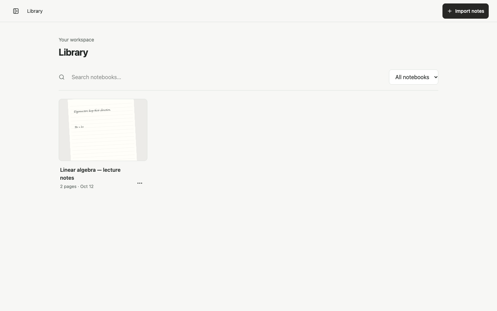
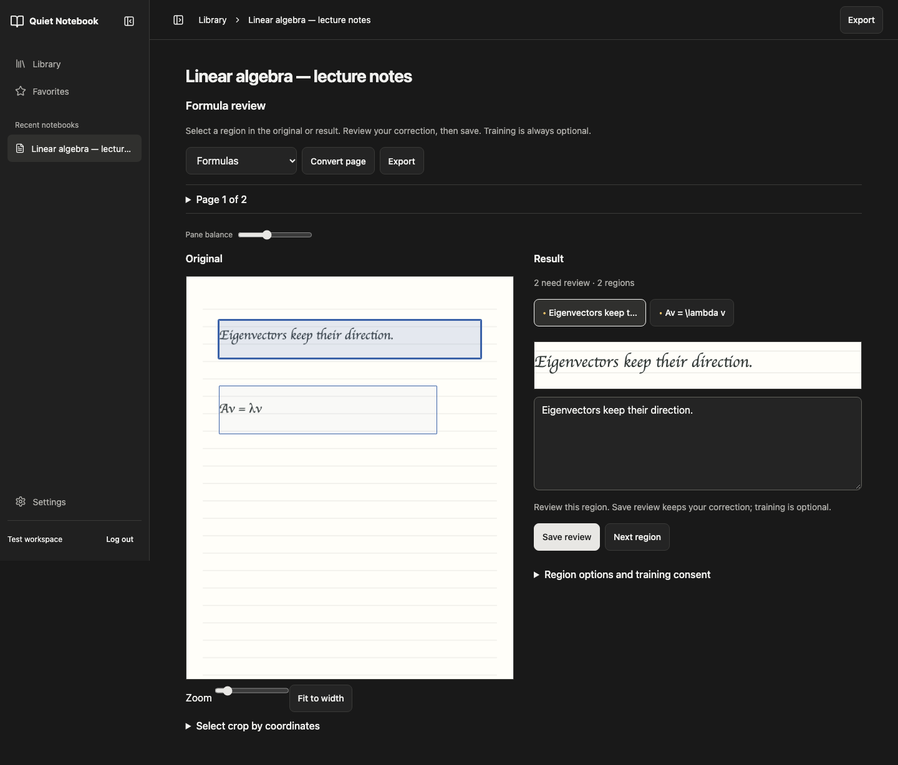
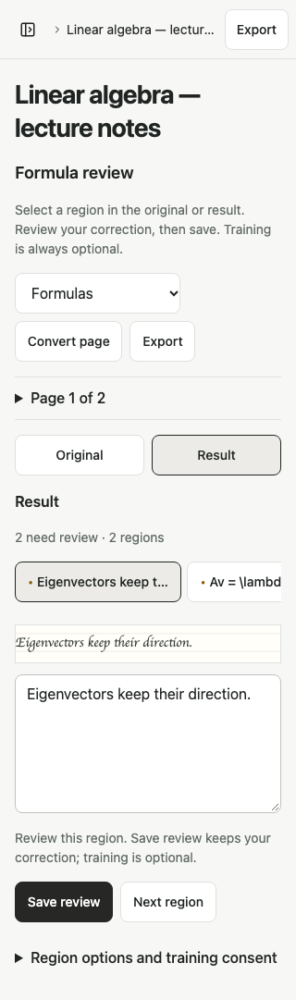

# Import, review and export

[Set up the app](getting-started.md) first. The screenshots below are generated
from the current production web build with a mocked API and synthetic lecture
notes. They show interface behavior, not recognition quality or a live backend.
The [capture manifest](../assets/screenshots/manifest.json) records source and
image hashes; see the [media workflow](../development/documentation.md#screenshots-and-videos).

## 1. Open Library and import notes

Choose **Import notes** and select a PDF, PNG or JPEG. Open a notebook from
Library to view its pages and retained source. The native app also supports
creating notebooks and drawing with PencilKit.

## 2. Review the result beside its source

Select a page and a region. When a compatible model is installed, request
prose or formula conversion. Compare the prediction with the highlighted source;
correct the prose or LaTeX and inspect the formula preview. Manual correction
remains useful when recognition is unavailable.

**Save** commits a reviewed revision. A save failure or version conflict keeps
the correction in the open page and offers retry/comparison. Unsaved web drafts
are lost on reload or closing the page. Saving a correction does not grant
training consent; that choice is explicit.

## 3. Export the saved review

Choose **Export**. If corrections are unsaved, choose **Save and export** or
**Export last saved version** deliberately. Web document exports include
Markdown, LaTeX, HTML, a LaTeX bundle and controlled PDF. Native original-source,
ink and converted exports have distinct purposes; compare the exported content
with the saved review.

## Appearance and small screens

Choose **Settings → Appearance → System / Light / Dark**. The preference is
stored locally; changing it does not alter original scans, ink or exports.
On small screens, navigation collapses and review places the selected source
above the correction.

| Dark desktop review | Compact light review |
| --- | --- |
|  |  |

Native offline persistence and browser connectivity have different limits.
Check [current status](../STATUS.md) before relying on an unverified workflow.
