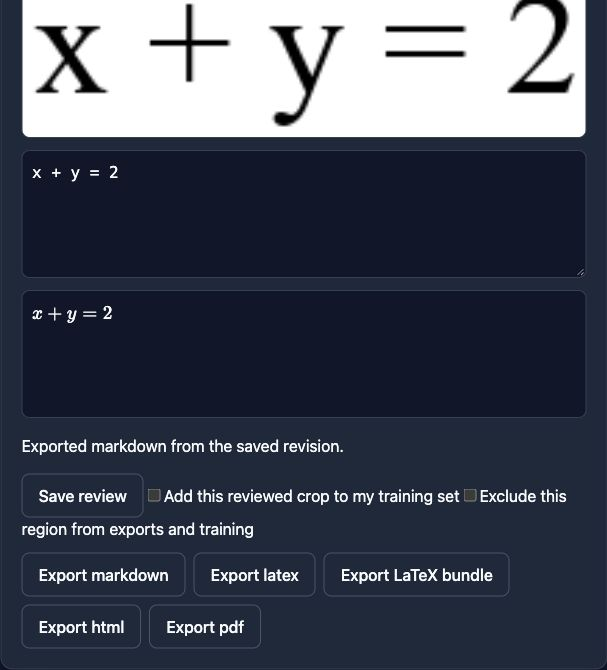

# Main verification — October 11, 2026

Date: **2026-10-11** (America/Toronto).

The local app, website, and installed formula/prose recognition journeys pass
on merged `main`. **A fresh PostgreSQL deployment fails its migration on main.**
A minimal fix and stronger foreign-key assertions are prepared, tested, and
uncommitted on `codex/main-verification-fixes`; they still need merging.
S3/MinIO integration could not be verified because the image registry refused
the MinIO downloads.

## Verified source

- Fetched and fast-forwarded local `main` to
  `aa79236883bb4f235439f9f75daaf1477ff5b2e2`, merge PR #2.
- Its tree matches the reviewed fix commit `5e1ccce` exactly.
- Main source fingerprint: `b385efbf4474292e89def7829a6a61d54bba2cb084ca120d4c20c7a7d2dd65a4`
  over 322 source files, using the method in the [fix report](REVIEW_FIXES_2026-10-11.md).
- Restarted the backend from this source at `http://127.0.0.1:8000`;
  the website remains at `http://127.0.0.1:5173` with its `/api` proxy.
- Xcode 16.4, iPad Pro 13-inch (M4), iOS 18.6 simulator; local ad-hoc signing.

## Results

| Check against merged main | Result |
| --- | --- |
| Full backend suite | **906 passed, 2 skipped**, 69.13 seconds |
| Website tests | **175 passed** |
| Website typecheck and production build | Passed |
| Swift package tests | **30 passed** |
| Signed iPad simulator app/test build | Passed |
| Native app unit tests | **33 passed** |
| Simulator UI: offline creation/relaunch, auth controls, page edits, exports, search, favorites | **6 passed**, 197.57 seconds |
| Native real-model UI: sign-in, source restore, formula/prose conversion, review save/reopen, Markdown sharing | **1 passed**, 69.40 seconds |
| Backend and website proxy health | Both installed task models loaded |
| Real-model HTTP journeys through website proxy | Formula and prose passed; idempotent retry, frozen source, saved correction/reopen, Markdown/LaTeX/HTML exports, and REST metadata sync events |
| Live browser | Fresh main-verification note opened, source crop and saved formula displayed, review saved, Markdown downloaded and checked for the saved correction |
| Existing SQLite schema | At migration head; no schema drift |
| Fresh SQLite migration chain and schema check | Passed |
| Generated contracts | All four artifacts match regeneration |
| Swift API model boundary | 31 model checks passed |
| OpenAPI validation | Valid; merge's first parent predates the v1 contract, so no compatibility baseline exists |
| Fresh PostgreSQL 17 migration | **Failed on main; passed with the isolated fix** |
| S3/MinIO service integration | Unverified: image downloads refused |

The baseline backend suite retains 299 dependency/fixture warnings. The two
default skips are PostgreSQL and S3 integration; PostgreSQL was subsequently
run separately against a disposable localhost-only container. All disposable
PostgreSQL containers and their data were removed after the checks. The
temporary production test dependencies were installed outside the checkout;
the application environments were not changed.

## PostgreSQL issue and prepared fix

Migration `9c8d7e6f5a4b` forcibly rebuilds `region_predictions` on every database.
On PostgreSQL, Alembic drops its primary key while `region_reviews` and
`review_revisions` still reference it, producing `DependentObjectsStillExist`.
The initial real PostgreSQL check reproduced this failure before any fix.

The prepared change rebuilds only SQLite and uses native PostgreSQL `ALTER
TABLE`. The same real integration test now passes, asserts that both review
foreign keys and the new model-assignment reference survive, and the fresh
PostgreSQL schema has no Alembic drift. Five SQLite migration regression tests
also pass. The migration revision remains unchanged so databases already at
head do not rerun it; failed or fresh PostgreSQL installs can complete the
existing chain once this fix is merged.

The fix changes only the migration and its existing integration test.
Working source fingerprint after the fix:
`2c9f68781e3b4a70bcce0d0a8a0571c011affe382a31b727b2bff72fed53d33e`
over 322 source files. **This fix is not yet on origin/main.**

## Limits and remaining checks

- MinIO's pinned Docker Hub image could not be pulled. The same release and
  the release in [upstream's compose example](https://github.com/minio/minio/blob/master/docs/orchestration/docker-compose/docker-compose.yaml)
  also returned `401 UNAUTHORIZED` through Quay. This is a concrete registry
  access/download blocker; no passing S3 integration or production-stack
  deployment claim is made.
- Legacy CRNN recognition/calibration and its personalization workflow remain
  unavailable without a compatible trained artifact. The tested formula and
  prose document-conversion paths use UniMERNet and TrOCR respectively.
- Public/synthetic fixtures prove working inference and persistence; they do
  not establish handwriting accuracy. Prose was deliberately edited to a test
  correction for export/persistence checks.
- Physical Apple Pencil behavior, representative accuracy, the complete live
  two-client interruption/conflict journey, HTTPS/Linux production deployment,
  backup/restore, and resource/battery measurements remain in the
  [dated TODO](../archive/remaining-work-2026-10-11.md).
- GitHub's legacy commit-status query returned no statuses; these results are
  local verification, not a claim that remote CI passed.

## Evidence

- [Real-model HTTP journey details](MAIN_LIVE_CONVERSION_2026-10-11.json).
- Browser download: `/Users/oweny/Downloads/notes (1).md`; saved formula verified.
- Local simulator results: `/private/tmp/hnd-main-ui-regression.xcresult`
  and `/private/tmp/hnd-main-real-model-ui.xcresult`.
- Raw sign-in logs and simulator bundles remain local; they are excluded from
  versioned evidence because UI automation may record credential keystrokes.

