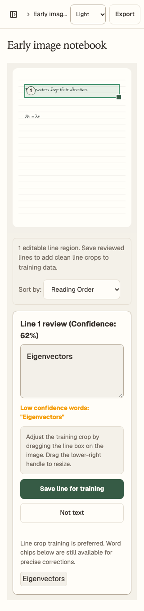
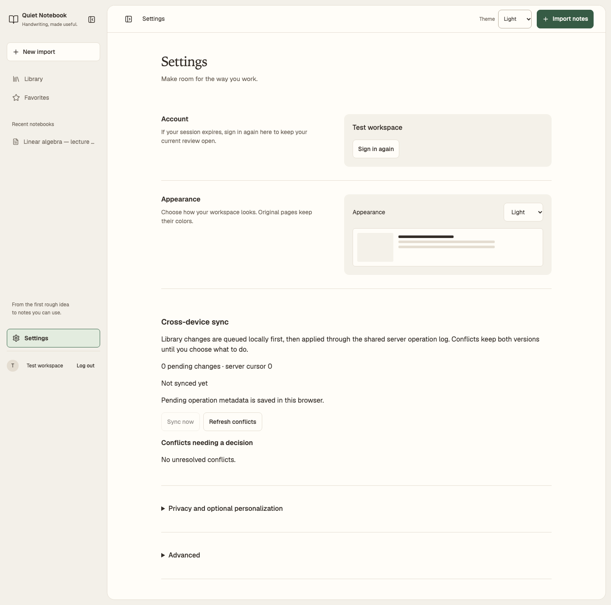
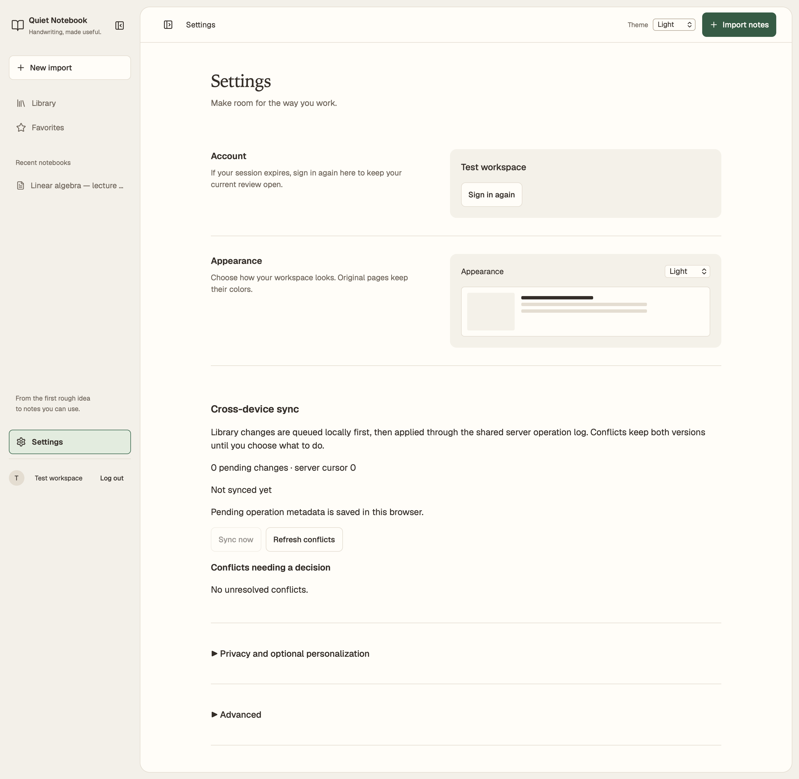
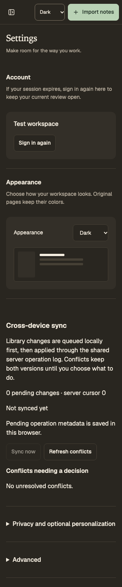
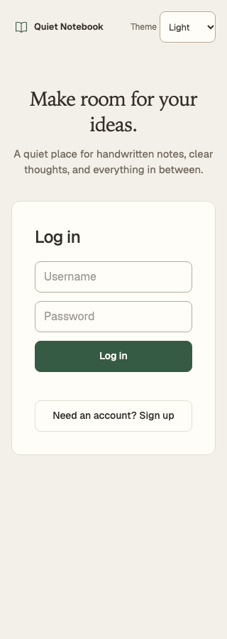
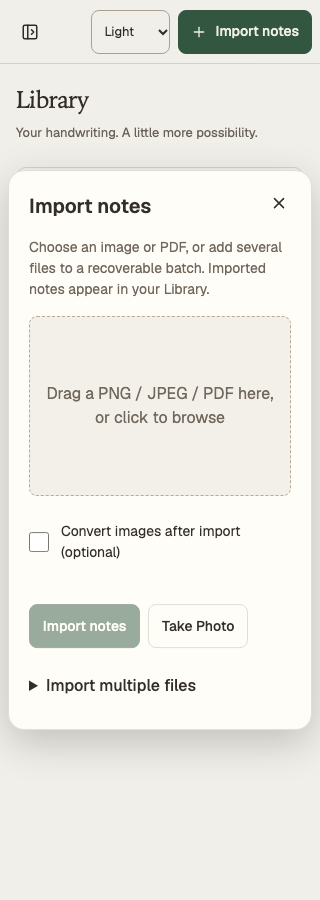
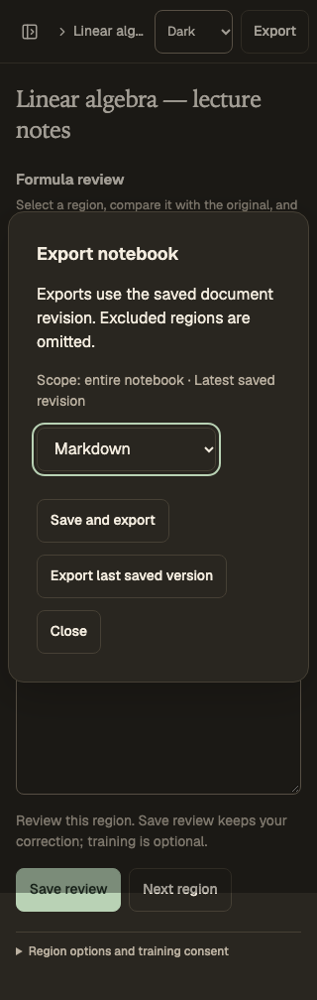

# Web UI audit, October 20, 2026

**Implementation integrity: FAIL.** The notebook workspace has a clear identity,
but shared controls and older Settings/review modules do not consistently apply
its typography, spacing and theme rules. This is a consistency failure, not a
finding that the whole interface needs rebuilding.

Audited source: `76a78eab7e44c2f6ac0e8d4cb398c484b0c80a41`. Application source
was unchanged during this audit. Findings describe that baseline; they are not
all attributed to the latest redesign.

## Summary

**13/20: Acceptable, with significant consistency work remaining.**
Nine verified issues: **0 P0, 1 P1, 7 P2, 1 P3**.

| Dimension | Score / 4 | Evidence |
| --- | --- | --- |
| Accessibility | 2 | Main journeys pass automated scans; the older image-review warning fails text contrast |
| Performance | 3 | Fast local synthetic review; representative libraries, networks and devices remain unmeasured |
| Responsive design | 3 | Main workflow reflows; expanded accuracy table overflows, mobile header gutters differ, WebKit controls shrink |
| Theming | 3 | Warm light/dark tokens work; sign-in System mode misses live OS changes and an old warning bypasses tokens |
| Implementation integrity | 2 | Settings typography, dropdown presentation, copy and dialogs drift across modules |
| **Total** | **13/20** | **Acceptable** |

Fix the warning contrast first. Then standardize typography and native-select
presentation, correct mobile gutters/table overflow, and finish the sign-in and
Settings details. Keep the warm palette, visible selection states and paired
source/correction workflow.

The user's dropdown crop shows a real control-spacing problem. It does not show
the surrounding page, so it cannot establish the page margin by itself. The
full-screen audit independently confirmed the mobile header's smaller inset.

## Scope and method

- macOS 15.8 arm64; Playwright 1.64.0 with Chromium, Firefox and WebKit engines.
  The local performance run identifies Chromium as `156.0.8078.4`.
- Production preview at port 4173; separate synthetic preview at 4181 for Taste
  inspection. The running development sign-in screen at 5173 was also inspected
  in the in-app browser without entering credentials or changing its settings.
- Chromium visual checks at 320, 768 and 1440 CSS pixels in light/dark themes;
  Settings comparisons at 320/1440 in Firefox/WebKit. Taste also inspected Settings
  at 390/768/1440. WebKit screenshots use a 2x device scale; measurements below
  are CSS pixels.
- Reviewed sign-in, registration, Library, text/formula review, older image-only
  review, import/export dialogs, Settings and expanded privacy/personalization.
  Existing automated journeys also cover menus, navigation drawers, focus return,
  region selection, failed imports and authenticated System appearance.
- Synthetic two-page notebook, SVG source, two regions, no recorded consent,
  empty training/evaluation data and an older image notebook with 62% confidence.
  No private notes, account changes, model inference or training were used.
- Impeccable source detector; Taste source lint and browser inspection; computed
  styles, geometry, Chromium platform-font evidence and axe checks. See the
  [measurements](ui-audit-2026-10-20/measurements.json),
  [source/image manifest](ui-audit-2026-10-20/manifest.json) and
  [performance samples](ui-audit-2026-10-20/performance.json).

## Findings

### A1 · P1 · Low-confidence warning is hard to read in light mode

**Location:** [editor.ts](../../frontend/src/modules/editor.ts), line 440,
`.editor-line-warning`. **Category:** Accessibility / Theming.

The older image-only review uses `var(--warning-color, #f59e0b)`, but the theme
defines `--amber`, not `--warning-color`. The orange fallback therefore renders
at **2.11:1** against `#fffdf8`, at 13.6px bold. Axe reproduced the failure at
320 and 1440 pixels. This is a
[WCAG 1.4.3 AA text-contrast failure](https://www.w3.org/WAI/WCAG22/Understanding/contrast-minimum.html);
this text requires at least 4.5:1.

**Impact:** People can miss the warning identifying recognition that needs review.
**Recommendation:** Use the existing semantic warning token and verify both
themes on the image-only path. **Suggested command:** `$impeccable harden`.



Synthetic image-only notebook, Chromium, light appearance, 320 CSS pixels.

### A2 · P2 · Settings uses competing type scales

**Location:** [styles.css](../../frontend/src/styles.css), lines 127, 629 and 1272;
[AppShell.tsx](../../frontend/src/components/AppShell.tsx), line 698;
[syncUI.ts](../../frontend/src/modules/syncUI.ts), line 51.
**Category:** Implementation Integrity.

Account and Appearance headings render at **16px** with **14px** supporting copy.
Cross-device sync uses an **18px** heading with **16px** paragraphs. Expanded
Calibration uses **16.8px / 14.4px**. The same level of Settings content therefore
looks as though it belongs to several interfaces.

Chromium platform-font inspection confirms Geist actually renders controls and
section text. Iowan Old Style renders the page title. The serif title/sans body
pair is intentional; a failed Geist download is not the cause of this drift.
The title face is a local platform font and will vary with the fallback stack
on other operating systems.

**Impact:** Unrelated sections compete for attention and the hierarchy feels
inconsistent, particularly on the phone. **Recommendation:** Apply one section
heading, supporting-copy and control scale across React and older DOM modules;
keep the title face in a clearly defined role. **Suggested command:**
`$impeccable typeset`.



Synthetic Settings, Chromium, light appearance, 1440 CSS pixels.

### A3 · P2 · Dropdown spacing and height depend on the browser

**Location:** [styles.css](../../frontend/src/styles.css), lines 146–152, 382 and
632; Theme controls in [AppShell.tsx](../../frontend/src/components/AppShell.tsx)
and [main.ts](../../frontend/src/main.ts), line 1044.
**Category:** Responsive / Implementation Integrity.

The header Theme select uses 13px type and uniform 8px padding. Settings uses
14px type and `8px 12.8px` padding. Both retain `appearance: auto`, leaving the
native arrow's placement to the browser. This reproduces the cramped arrow in
the supplied crop. More significantly, **WebKit renders the controls at 22px and
23px high**, while Chromium and Firefox render them at 44px.

**Impact:** One setting looks and feels different across locations and browsers;
the WebKit controls fall below the project's intended 44px target.
**Recommendation:** Share select styling, an explicit usable height, text inset
and reserved chevron space, while preserving native select semantics/keyboard
behavior. Recheck WebKit rather than relying on computed `min-height` alone.
**Suggested command:** `$impeccable harden`.

This is a project usability/design-system finding. A sub-44px target alone does
not prove an AA violation: [WCAG 2.5.8](https://www.w3.org/WAI/WCAG22/Understanding/target-size-minimum.html)
uses 24px with spacing and other exceptions.



Synthetic Settings, WebKit, light appearance, 1440 CSS pixels / 2x scale.

### A4 · P2 · The phone header has a different edge inset

**Location:** [styles.css](../../frontend/src/styles.css), lines 1642–1651.
**Category:** Responsive.

Below 640px the header has **8px** horizontal padding, while the content has
**16px**. The Import/Export button ends 8px from the viewport edge, visibly
outside the content's alignment. Desktop uses a separate 28px header inset.

**Impact:** The permanent action feels crowded against the phone edge, matching
the user's concern about breathing room. **Recommendation:** Use a consistent
phone gutter and balance the navigation, theme and action controls within it.
Keep the title truncation deliberate and the main action reachable.
**Suggested command:** `$impeccable layout`.



Synthetic Settings, Chromium, dark appearance, 320 CSS pixels.

### A5 · P2 · Expanded accuracy table causes horizontal page scrolling

**Location:** [beforeAfterView.ts](../../frontend/src/modules/beforeAfterView.ts),
line 807; table presentation in [styles.css](../../frontend/src/styles.css).
**Category:** Responsive.

At 320px, the empty accuracy table is **320.7px** wide inside a **288px** content
area. Its right edge reaches x=336.7 and the page's scroll width becomes **337px**.
Cells have no padding, so repeated `unavailable` values also run together on
desktop. The collapsed Settings journey does not exercise this state.

**Impact:** Reading the final metric requires moving the entire phone page
sideways; adjacent values are difficult to associate with their columns.
**Recommendation:** Give the table deliberate cell spacing and a contained
responsive presentation; consider one clear empty state when no evaluation
exists. Preserve actual values and accessible headers when data is available.
**Suggested command:** `$impeccable adapt`.

[Expanded Settings capture](ui-audit-2026-10-20/privacy-light-320.png), synthetic
no-consent/no-evaluation state, Chromium, light appearance, 320 CSS pixels.

### A6 · P2 · System theme stops following OS changes before sign-in

**Location:** [main.ts](../../frontend/src/main.ts), lines 1048–1049, and
[appearance.ts](../../frontend/src/appearance.ts).
**Category:** Theming.

With System selected on sign-in, changing the emulated OS appearance from light
to dark leaves `data-theme="light"`. A reload resolves it correctly. The
authenticated shell already listens for OS changes; the welcome screen does not.

**Impact:** The same System option behaves differently before and after login.
**Recommendation:** Reuse the existing live system-appearance behavior for the
welcome screen with appropriate listener cleanup. **Suggested command:**
`$impeccable harden`.

### A7 · P2 · Sign-in fields lose their visible labels after typing

**Location:** [authGate.ts](../../frontend/src/modules/authGate.ts), lines 49–77.
**Category:** Accessibility / Usability.

Username, email and password are identified visually only by placeholders. Their
`aria-label` values are present and the automated label checks pass, but entering
a value removes the visible cue. Registration also reveals the password-length
requirement only after submission.

**Impact:** People must remember each field's purpose and discover validation
requirements by failing. **Recommendation:** Keep visible labels, show the
registration password requirement next to the field, and associate validation
help with the relevant input. This is not reported as a missing accessible-name
violation. **Suggested command:** `$impeccable clarify`.



Synthetic signed-out screen, Chromium, light appearance, 320 CSS pixels.

### A8 · P2 · Everyday Settings copy reads like a diagnostic tool

**Location:** [syncUI.ts](../../frontend/src/modules/syncUI.ts), lines 58 and 146;
personalization sections in [beforeAfterView.ts](../../frontend/src/modules/beforeAfterView.ts).
**Category:** Implementation Integrity / Usability.

The main sync section exposes `server cursor 0`, a `shared server operation log`
and `pending operation metadata`. Expanded personalization adds epochs and model
routing evidence before a person has any training data. These are truthful
details, but their prominence conflicts with the requested cozy research workspace.

**Impact:** Routine account/settings use requires translating implementation
terms into practical meaning. **Recommendation:** Lead with changes waiting,
last sync and any action needed. Place diagnostic identifiers and model-routing
details behind a clearly named advanced disclosure. Preserve consent choices,
recovery explanations and limits. **Suggested command:** `$impeccable clarify`.

### A9 · P3 · Import and notebook export use different dialog conventions

**Location:** [primitives.tsx](../../frontend/src/components/ui/primitives.tsx),
line 61; [mathNotes.ts](../../frontend/src/modules/mathNotes.ts), line 719;
[styles.css](../../frontend/src/styles.css), lines 592–611.
**Category:** Implementation Integrity.

Import has a 20px title, 14px muted description and a top-right close icon.
Notebook export has an 18px title, 16px body text and a footer Close button.
Its save/export actions also share the same visual weight. Both dialogs remain
operable; this is a polish issue rather than a reason to rewrite their behavior.

**Impact:** Moving between related actions changes the visual hierarchy and
dismissal location. **Recommendation:** Align title/body/action styling and the
close convention, keeping explicit saved-version export and focus behavior.
**Suggested command:** `$impeccable polish`.

| Import | Export |
| --- | --- |
|  |  |

Synthetic Chromium dialogs, 320 CSS pixels. Different themes illustrate both
appearances; the finding concerns typography and controls, not the theme difference.

## Patterns and positive findings

The principal gap is incomplete application of the existing design system across
React shell elements and older DOM modules. It produces the type-scale, control,
copy and dialog differences above. Fix shared rules at their common boundary;
avoid introducing a second component system or replacing functioning workflows.

Keep these strengths:

- The warm light/dark palette, loaded handwriting previews and paired original /
  correction view make the product recognizable and useful.
- Selected navigation and source regions use fill, border and text weight;
  selection is substantially clearer than before.
- Main workflow controls generally have 44px heights, readable contrast and
  reachable keyboard focus. Import focus trapping/return and region selection
  passed in all three browser engines.
- Original page colors remain intact across themes. Empty/no-evaluation states
  do not invent model accuracy or training results.
- Images lazy-load, math code is split from the entry bundle, and animations are
  brief. Reduced-motion styles remove decorative transition/animation effects;
  selection and focus remain visible without movement.

## Detector triage

**Fixed:** none; this was an audit, with application source left unchanged.
**New persistent suppressions:** none. **Left standing:** A1–A9 above.

- Impeccable source scan: **0 findings** with the existing project configuration.
  The existing narrow Geist exception remains: it was the chosen Taste direction
  font. No file/rule-wide ignore was added.
- Focused Taste lint of the shell, primitives, styles, startup and auth: **0 FAIL,
  5 WARN**. Four shadows belong to actual menus/dialogs/floating controls; the
  monospace rule applies to LaTeX source. These are intentional, not new defects.
- The broader lint initially included `example.com` in test data, and text warning
  symbols in older modules. Test addresses are fixtures, not product placeholder
  content; warning/check symbols convey status. The hard-coded orange warning was
  investigated and promoted to A1 rather than dismissed with those findings.
- Taste Settings inspection: **0 FAIL, 2 WARN** after a one-run `--allow no-title`.
  The initial no-title result selected a hidden Library heading despite a visible
  Settings h1. The allowance is limited to this inspection command; no project
  ignore was persisted. The local-font warning was disproved on this Mac using
  Chromium platform-font evidence for Iowan Old Style. The cream warning reflects
  the user's explicit request for warmer surfaces; the green/paper choice remains.
- Source crops extending past their clipped preview viewport are intentional
  source-region geometry, unlike the uncontained table overflow in A5. Small
  checkbox squares have larger containing labels; they were not automatically
  reported as undersized touch targets.

## Taste screenshot critique

ROUND 1

Seen in one second: a quiet notebook library and a warm paper Settings sheet.

Idea (one sentence): keep original handwriting close to clear, editable notes
inside a personal research folio.

Live thing: import pages, select source regions, correct notes and explicitly
save/export a chosen revision.

Layout words by section: Library=shelf / review=paired sheets / Settings=split
rows then full-width diagnostics / import=drop zone / export=action form.

Scores: design **6.5** · usability **7** · creativity **7** · content **7** →
overall **6.8/10**.

Caps applied: the app-specific rules apply; marketing-page requirements for
multiple photographs, hero motion and oversized display type do not. The verified
hidden-heading/font warnings are not visual failures. Settings' inconsistent
composition and type scale keep design at 6.5; the notebook idea can also fit a
nearby notes product, so creativity remains at 7.

Top three problems, most visible first:

1. Settings switches from compact split rows to larger full-width text.
   Evidence: `settings-light-1440.png`. Apply the same section hierarchy and
   layout rhythm to Sync and optional settings.
2. Theme controls lack a stable inset/height and the phone header sits nearer the
   edge than its content. Evidence: `settings-webkit-light-1440.png` and
   `settings-dark-320.png`. Normalize selects and the phone gutter.
3. Expanded optional settings turn into a diagnostic report with an uncontained
   table. Evidence: `privacy-light-320.png`. Lead with status, group advanced
   detail and make the table fit its container.

## Verification and practical limits

| Check | Result |
| --- | --- |
| Temporary audit capture/measurement journey, all three engines | 3 passed; 32 Chromium captures plus 4 Settings captures in each other engine |
| Additional axe scans in that journey | 14 scans; 12 with no violations, 2 reproduce the same A1 contrast defect |
| Existing appearance, accessibility and keyboard journeys | 9 passed across three engines; 30 accessibility states per engine had no reported violations |
| Existing local lab performance journey | 1 Chromium run passed; five samples per profile |
| Documentation links/navigation/media provenance | `make docs-check` passed |

The extended capture journey uses the existing notebook fixture, supplies valid
empty personalization responses, opens the privacy disclosure, injects a valid
image-only notebook/low-confidence result, measures visible type/control geometry,
and changes emulated OS appearance while signed out. Its ordinary raw output is
under ignored `frontend/test-results/ui-audit-2026-10-20/`; selected evidence above
is preserved separately. No release report or current screenshot was overwritten.
The existing regression command was:

```bash
cd frontend
npx playwright test e2e/workspace.spec.ts \
  --grep 'accessibility scan|keyboard navigation|system appearance' \
  --output=test-results/ui-audit-regressions --reporter=line
npx playwright test e2e/workspace.spec.ts --project=chromium \
  --grep 'record local lab' --output=test-results/ui-audit-performance --reporter=line
```

Local LCP medians were **104ms** desktop and **204ms** at 390px/4x CPU; maximum
observed CLS was **0** in both profiles. Largest observed Event Timing duration
was **40ms** desktop and **16ms** with CPU throttling. These are synthetic local
samples, not field INP, real-device performance or representative-network results.
Entry JavaScript is 508,175 bytes / 154,058 gzip; the separate math chunk is
284,008 / 83,797 gzip; the variable Geist asset is 169,056 bytes uncompressed.
No measured performance regression is claimed.

Automated checks do not establish full WCAG conformance: axe also reports rules
needing manual review. Screen-reader use, physical phones/tablets, Windows/Linux
font rendering, browser text-only zoom, long real notebooks, real camera use,
model quality and native iPhone/iPad UI were not tested in this audit.

Documentation impact: audit evidence and known limits changed. No frontend
implementation changed, so `make docs-screenshots` was not rerun; existing current
screenshots still match their source manifest.

## Recommended actions

1. **P1 · `$impeccable harden`:** resolve A1's warning contrast.
2. **P2 · `$impeccable typeset`:** unify Settings typography (A2).
3. **P2 · `$impeccable harden`:** normalize selects and live System behavior (A3, A6).
4. **P2 · `$impeccable layout` / `$impeccable adapt`:** align phone gutters and
   contain the accuracy table (A4, A5).
5. **P2 · `$impeccable clarify`:** persistent form labels and useful Settings copy
   (A7, A8).
6. **P3 · `$impeccable polish`:** align dialog hierarchy and dismissal, then check
   the completed changes together in both themes (A9).

These actions can be run one at a time, together, or in another order. Re-run
`$impeccable audit` after the fixes; the score above describes the audited baseline.
