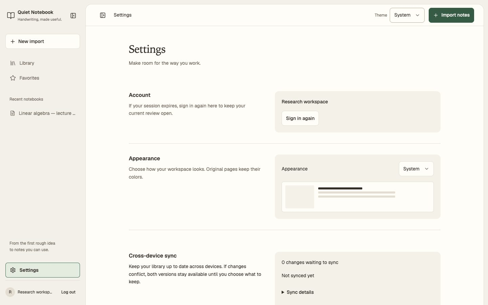

# Web UI fixes, October 20, 2026

The [preceding audit](ui-audit-2026-10-20.md) documented nine issues without
changing the app. This follow-up implements those corrections. The original
audit and its screenshots remain historical baseline evidence.

The exact frontend inputs are recorded in this
[source/image manifest](ui-fixes-2026-10-20/manifest.json), based on `76a78ea`
plus the corrections in this change. Current Library/review captures have their
own [source manifest](../assets/screenshots/manifest.json).

## Implemented corrections

| Audit item | Result |
| --- | --- |
| A1 · Warning contrast | Older image-review warnings use the semantic amber theme token; both themes pass the extended axe check |
| A2 · Settings typography | Section headings share 16px/600; copy and controls share 14px/1.6; Sync follows the same split-row composition as Account/Appearance |
| A3 · Native selects | One 44px control height, 14px type, a chevron inset 12px from the edge and 40px reserved text padding; native select semantics remain |
| A4 · Phone gutters | Header and content use a 16px horizontal inset; toolbar action padding leaves room at 320px |
| A5 · Accuracy table | Fixed table layout, cell padding, wrapping and smaller data text contain the table inside the Settings column |
| A6 · System appearance | A shared listener follows live OS changes before/after sign-in and is removed when its surface is disposed; explicit overrides remain stable |
| A7 · Form labels | Username/email/password retain visible labels; registration displays and associates the eight-character requirement before submission |
| A8 · Diagnostic copy | Sync leads with pending changes/last sync; cursor/storage details and training/model evidence sit behind disclosures |
| A9 · Dialog conventions | Notebook export shares the title/description scale and top-right close convention; Save and export has primary emphasis |

The serif page-title / Geist interface pairing remains deliberate. No font
dependency, framework or data model was changed. Consent choices, unsaved drafts,
source fidelity and explicit saved-version export behavior remain covered by
the browser journeys.

## Visual evidence

Production build, synthetic Settings account, mocked API, empty consent/training
data. These images do not establish backend or model behavior. Desktop and tablet
show the same section hierarchy; the phone stacks those sections.

[Tablet Settings](ui-fixes-2026-10-20/tablet-fold.jpg) ·
[Phone Settings](ui-fixes-2026-10-20/mobile-fold.jpg)

The browser checks also exercised light/dark appearance at 320/1440px, expanded
privacy/model sections, the accuracy table and the older image-only review.
The running development sign-in page was inspected in the in-app browser and
showed the updated chevron inset and persistent field labels. Notebook export
was visually checked in an isolated synthetic preview.

## Verification

Environment: macOS 15.8 arm64, local production build, Playwright 1.64.0 Chromium,
Firefox and WebKit engines. Inputs are synthetic; no model was run and no real
account or note was modified.

| Check | Result |
| --- | --- |
| `npm run build` | Passed; existing large-entry-chunk advisory remains |
| `npm test` | 179 passed |
| `npx playwright test --output=test-results/ui-fixes-full --reporter=line` | 42 passed, 6 intentional skips; [recorded output](ui-fixes-2026-10-20/browser-results.txt) |
| New Settings regression journey | All engines verify 44px controls, reserved arrow space, a uniform heading scale, no page overflow and expanded-state axe results at 320/1440px in both themes |
| Older image-review journey | Both themes pass axe in all engines with a synthetic low-confidence result |
| Existing sign-in/draft journey | Live signed-out System changes, persistent override/labels, password help and draft preservation pass in all engines |
| `make docs-screenshots` | Passed; all eight current images inspected with their refreshed manifest |
| `make docs-check` | Passed |
| Impeccable type scan | No findings with the existing narrow Geist exception |
| Taste Settings inspection | 0 FAIL, 3 reviewed WARN at 1440/768/390px; [inspection](ui-fixes-2026-10-20/inspection.json) |

The six skips are three opt-in live-API/offline journeys, two non-Chromium lab
performance cases, and the existing mocked WebKit service-worker case. The
ordinary Chromium/Firefox cached-shell recovery journeys did run.

The broader fixture now supplies backend-shaped boolean capabilities and valid
empty personalization responses. The common fixture deliberately marks optional
tools unavailable; the expanded-Settings regression explicitly enables them.
Current Library/review documentation therefore includes a truthful synthetic
capability banner instead of accidentally treating capability objects as true.

Taste's warnings are the requested warm paper palette, a local serif incorrectly
classified as unloaded, and a chart-color heuristic on a Settings screen without
data charts. The one-run hidden-heading allowance remains limited to the
inspection command. No new persistent rule/value/file suppression was added.

ROUND 2

Seen in one second: a warm Settings sheet with the same type and alignment across
Account, Appearance and Sync.

Idea (one sentence): keep a practical research folio comfortable and predictable.

Live thing: choose a theme, inspect sync state, manage consent and return to
source-linked review.

Layout words by section: Account=split row / Appearance=split row / Sync=split
row / optional tools=disclosure.

Scores: design 7.5 · usability 8 · creativity 7 · content 7.5 → overall 7.6/10.

Caps applied: app-screen rules; marketing imagery and motion requirements do not
apply. The retained folio idea also fits a neighboring notes product, so
creativity remains at 7.

Top three remaining limits: physical touch/assistive-technology use is unverified;
local serif fallback differs by OS; large real libraries and long sessions remain
outside these synthetic checks. No remaining A1–A9 implementation issue was found
in the exercised states; this is targeted correction evidence, not a new claim
of complete accessibility conformance.
